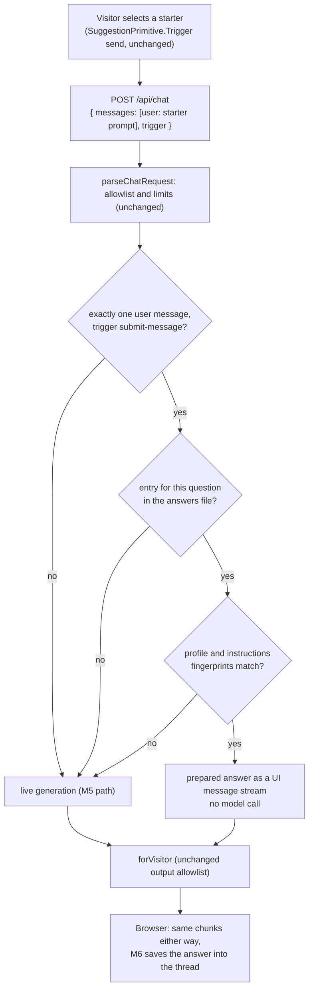
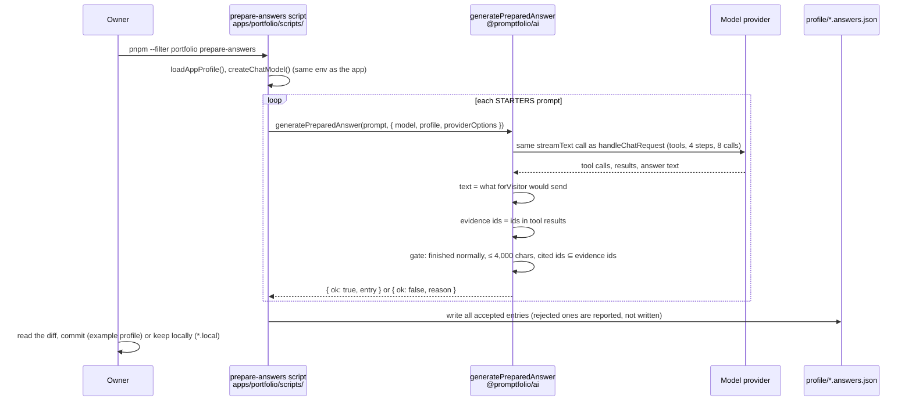
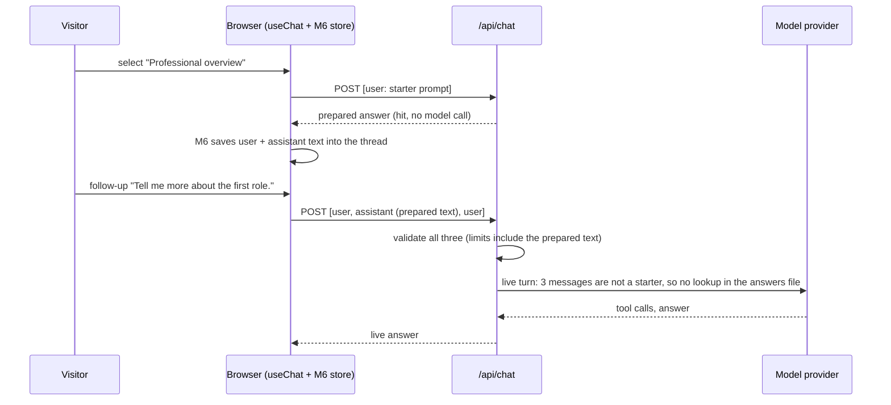
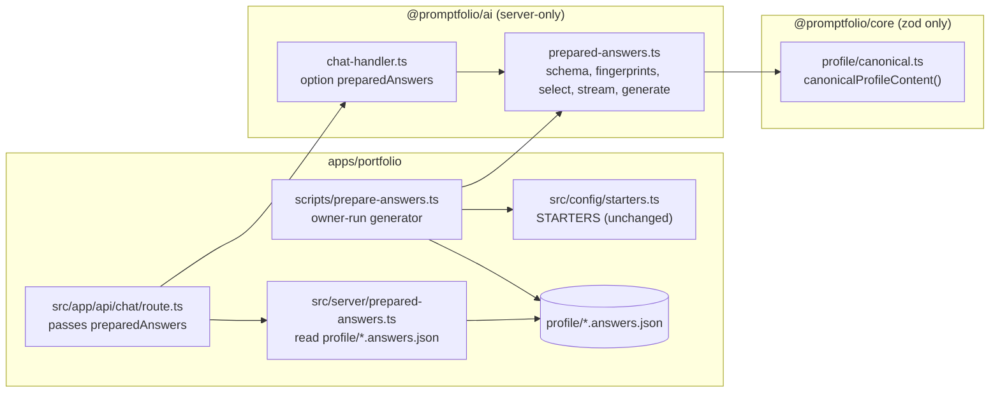
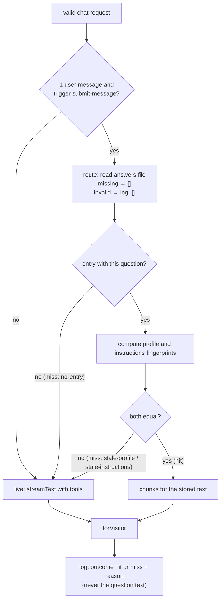

# M7 plan: Prepared starter answers and cache invalidation

- **Status:** Done (2026-10-29). Plan approved with the recommended defaults and implementation
  approved on 2026-10-29. See [Review results](#review-results).
- **Date:** 2026-10-29
- **Roadmap:** [M7 — Seeded conversations and cache behavior](../ROADMAP.md#m7--seeded-conversations-and-cache-behavior)

This plan is self-contained so it can be discussed outside the coding session. Background:
[architecture overview](../ARCHITECTURE.md), [M5 plan](m5-tools-grounded-lookup.md) (output
allowlist, budgets, "Deferred to M11"), [M6 plan](m6-browser-conversation-persistence.md) (trust
model, storage limits), [ADR 0001](../adr/0001-reference-app-framework.md) (serverless: no
in-memory state survives), [ADR 0002](../adr/0002-library-first-monorepo-boundaries.md) (package
boundaries), [ADR 0007](../adr/0007-chat-ui-assistant-ui.md) (assistant-ui), and the learning
notes on [tool calling](../learning/tool-calling.md),
[browser persistence](../learning/browser-persistence.md),
[validation at boundaries](../learning/validation-at-boundaries.md), and
[model requests and tokens](../learning/model-requests-and-tokens.md).

## Objective

Selecting a starter shows a useful, grounded answer at once, without a model call, as long as
that answer was prepared from **exactly the current profile content**. The owner prepares the
answers with a script that runs the normal chat pipeline (same instructions, tools, budgets, and
output allowlist), reviews them, and commits them as a JSON file next to the profile. Each answer
carries a fingerprint of the profile content and of the instructions it was produced with. When
either no longer matches, the server does not use the answer and generates a live one instead.
Follow-up questions are always live. The browser cannot tell the two paths apart, and the M5 and
M6 guarantees are unchanged.

## Starting point (after M6)

- `STARTERS` (`apps/portfolio/src/config/starters.ts`) is a list of `SuggestionConfig`
  (`{ title, label, prompt }`). The vendored `ThreadSuggestionItem` uses
  `<SuggestionPrimitive.Trigger send>`, so a starter sends its `prompt` as the first user message
  of a new thread: a normal `/api/chat` request. Starters are profile-independent on purpose.
- Every starter costs a full live turn: typically 2 model calls (list, then answer), 1,700 to
  3,000 input tokens, and 4 to 8 seconds (M5 review). Gemini's free tier (15 requests per minute)
  already rejected back-to-back questions during M5's review.
- `handleChatRequest` (`@promptfolio/ai`) validates the request (input allowlist, limits), runs
  `streamText` with the two profile tools, and filters the stream through `forVisitor` (output
  allowlist: `start`, `start-step`, `finish-step`, `text-start`, `text-delta`, `text-end`,
  `finish`, `error`, `abort`; `providerMetadata` stripped). The request schema strips every field
  except `messages`, including `trigger`.
- The route (`apps/portfolio/src/app/api/chat/route.ts`) reads the profile file on every request
  (`loadAppProfile()`); nothing is kept in memory. `observedAt` for every record is the profile
  file's modification time.
- M6 saves every answer the browser receives into `localStorage` and sends the whole thread back
  on each follow-up; the server validates it like any request. `CHAT_LIMITS.maxMessageChars`
  (4,000) applies to **every** message, assistant messages included.
- Carried-forward limitations: the client controls conversation history and can forge earlier
  assistant text; no rate limiting before M11; no public deployment before M11; no profile
  versioning before M9.

## Concepts introduced

1. **Prepared (precomputed) answers.** Some questions are asked by almost every visitor and have
   the same correct answer for all of them. Computing that answer once, ahead of time, and
   serving the stored result trades freshness for cost and latency. The trade is only safe if the
   app can tell when the stored result is no longer correct.
2. **Cache key and validity check.** A stored answer is looked up by its question and is valid
   only if everything that determined it is unchanged. Here that is (a) the profile content and
   (b) the instructions and tool definitions the model saw. The question selects the entry; the
   fingerprints decide whether it may be used.
3. **Content fingerprints.** A fingerprint is a SHA-256 hash of a stable (canonical) serialization
   of some data: equal content gives an equal fingerprint, and any change gives a different one.
   Comparing fingerprints needs no version counter, no database, and no memory between requests.
   Choosing *what goes into* the serialization is the real design decision (see open decision 3).
4. **Fail-safe invalidation.** A mismatch never produces an error and never serves the old answer:
   it falls through to normal live generation. "Stale" therefore costs a model call, never
   correctness. This is how the spec's "do not knowingly serve stale answers" is enforced in code.
5. **Same pipeline, different time.** The generator runs the exact live path (instructions, tools,
   step and call budgets, output allowlist) and stores only what a visitor would have received.
   A prepared answer is a recorded live answer, not a hand-written one.
6. **A stream without a model.** The AI SDK UI message stream is just a sequence of chunks. A hit
   is served by writing the chunks for one text answer and sending them through the same
   `forVisitor` filter, so the browser (and M6's storage) cannot tell the difference.

## Design

### What a starter does (open decision 1)



The starter itself does not change: it still sends a real first message, and the server decides.
The match is on the question text (exact, after trimming), not on a starter id, so:

- a visitor who types the exact starter text gets the same prepared answer (harmless: it is the
  answer everyone gets);
- editing a starter's prompt automatically turns its entry into a miss until it is regenerated;
- no client change is needed, and the client cannot ask for "the cached answer" by any special
  field.

`trigger: "regenerate-message"` (the visitor pressed "regenerate" on the answer) always goes
live: the visitor asked for a new answer, and returning the identical text would look broken
(open decision 5). This needs `parseChatRequest` to keep `trigger` as an optional
`"submit-message" | "regenerate-message"` value; it is metadata, not content, and the default is
`submit-message`.

### Where answers are produced and stored (open decision 2)



- **Produced** by a manual script the owner runs after editing the profile (or later, in M9,
  after a refresh). Not at build time (a build would need a provider key, depend on the
  provider being up, and produce different output each time) and not on first request (on
  serverless there is nowhere to keep the result without a new storage service; ADR 0001).
- **Stored** as a JSON file next to the profile it belongs to, read by the route on each request
  exactly like the profile file. The deployment artifact *is* the storage: no new service, no
  secret, nothing in memory, and the answers are versioned and reviewed in Git like the profile.
  This replaces ADR 0001's expectation that "the answer cache (M7) will need small external
  storage"; recorded in a new ADR (open decision 9).
- **File name:** the profile file name with `.json` replaced by `.answers.json`
  (`example.profile.json` → `example.profile.answers.json`, committed with the fictional profile;
  `profile.local.json` → `profile.local.answers.json`, gitignored through a new
  `*.local.answers.json` line, because it contains real profile facts). It is derived from the
  already validated profile file name, so the existing "inside `profile/`" guard covers it.
- **Owner review:** because answers are committed files, the owner reads every prepared answer
  before any visitor sees it. A live answer cannot get that review.

File format (validated with zod when read; the file is untrusted input like any other):

```json
{
  "formatVersion": 1,
  "answers": [
    {
      "question": "Give me a short professional overview.",
      "text": "Jordan is a … [platform-engineer-acme]",
      "profileFingerprint": "sha256:9f2c…",
      "instructionsFingerprint": "sha256:41ab…",
      "evidenceIds": ["platform-engineer-acme", "service-catalog"],
      "model": "google:gemini-3.8-flash",
      "generatedAt": "2026-10-30T09:00:00.000Z"
    }
  ]
}
```

`evidenceIds`, `model`, and `generatedAt` are for review and debugging; they are not part of the
validity check. Schema limits: at most 20 answers, unique questions, `question` within
`CHAT_LIMITS.maxMessageChars`, `text` 1 to 4,000 characters (see "Interaction with M6"), ids
matching the core id pattern, strict keys. An invalid file is logged once per request and treated
as empty: every starter goes live.

### Cache key, fingerprints, and invalidation (open decision 3)

| Part | What it is | Changes when |
| ---- | ---------- | ------------ |
| `question` | The exact first user message, trimmed | A starter's prompt is edited |
| `profileFingerprint` | `sha256:` + SHA-256 of `canonicalProfileContent(profile)` | Any profile fact changes: identity, links, any record field, record order, skills, sources' ids, kinds, labels, urls |
| `instructionsFingerprint` | `sha256:` + SHA-256 of the system prompt plus the tool names, descriptions, and input schemas | `system-prompt.ts` or `profile-tools.ts` changes in a way the model would see |

`canonicalProfileContent(profile)` (new, in `@promptfolio/core`) is a JSON serialization of the
validated `Profile` with object keys sorted (array order kept, because it is meaningful) and the
**observation timestamps left out** (`provenance.observedAt`, `sources[].retrievedAt`). Why
exclude them: today they are the profile file's modification time, which changes on every save
and every `git checkout` without any fact changing, and in M9 a refresh that finds identical data
must not invalidate every answer. The consequence is documented as a limitation: a prepared
answer that happens to quote an observation date may show an older date than a live answer would.
The generator does not ask for dates, and the M5 system prompt mentions them only when a visitor
asks where a fact comes from.

The whole profile is one dependency: any change invalidates every prepared answer. That is
deliberately conservative. Per-answer dependencies (fingerprint only the records in `evidenceIds`)
would invalidate less, but an answer like "there is no open-source work in the profile" depends on
records that are *absent*, which an evidence list cannot capture. With 5 starters, regenerating
all of them costs about 10 model calls.

**Relation to M9:** M9 adds profile versions. The content fingerprint can become (or be stored
with) the version id, and a refresh that publishes a new version can rerun the generator. M7's
check keeps working unchanged in between: a refreshed profile with new facts is simply a miss.

### How M5's guarantees are kept

- **Grounded in tool results:** the generator calls the same internal turn function as
  `handleChatRequest` (the `streamText` call is extracted, not copied), so the answer comes from
  the same tools, rules, and budgets.
- **Cited record ids:** the answer text keeps its inline `[id]` citations. The generator also
  collects the ids that the tools actually returned (`evidenceIds`, from `result.steps[].toolResults`)
  and **rejects** an answer that cites an id not among them, so a stored answer never carries a
  citation its own lookups did not support (open decision 6). This is a narrow, stored-answers-only
  form of the M11 citation check; M11 still builds the general one and the sources block.
- **No tool chunks in the browser:** the stored `text` is read from the `forVisitor`-filtered
  stream (`readUIMessageStream`), so it contains only what a visitor would have seen. A hit is
  built from `start`, `start-step`, `text-start`, one `text-delta`, `text-end`, `finish-step`,
  `finish`, and still goes through `forVisitor`.
- **Output allowlist unchanged:** no new chunk types, no message metadata, no "prepared" flag
  reaches the browser (open decision 7).
- **Server-side validation unchanged:** the request is parsed before the lookup; a hit happens
  only for a valid request.

### Interaction with M6's browser persistence



- A prepared answer is saved into the thread like any answer and continued live. The server
  treats the saved prepared text exactly like any client-sent assistant text: untrusted, not
  evidence ("Earlier messages in the conversation are not evidence" in the system prompt), so
  the follow-up looks records up again.
- **Limit:** `parseChatRequest` rejects any message over 4,000 characters, assistant messages
  included. A prepared answer longer than that would break every follow-up, so the generator
  rejects it and the file schema caps `text` at `CHAT_LIMITS.maxMessageChars`. A test sends a
  follow-up after the stored answer through `handleChatRequest`.
- A thread saved before a profile change still shows the answer it received then. That is M6's
  existing limitation for every saved answer, not new; new questions use the current profile.

### Where the code lives (open decision 4)



- `@promptfolio/core` gains one pure, synchronous function, `canonicalProfileContent(profile)`.
  What counts as "the profile's content" is profile logic, reusable without a model (M9's change
  detection needs the same answer). Core stays zod-only: no hashing, no Node or DOM types (its
  `lib` is `ES2023` only).
- `@promptfolio/ai` gains `prepared-answers.ts`: the file schema (`parsePreparedAnswers`),
  `profileFingerprint` and `instructionsFingerprint` (SHA-256 through the global Web Crypto
  `crypto.subtle.digest`, the same global family as the `crypto.randomUUID()` the handler already
  uses, so no Node import and no provider dependency), `selectPreparedAnswer` (returns a hit or a
  miss reason), the hit stream, and `generatePreparedAnswer`. `handleChatRequest` gets one new
  option, `preparedAnswers?: PreparedAnswer[]` (absent or empty means "always live", so every
  existing caller and test is unaffected). The package stays storage-agnostic: it receives
  entries, it never reads files.
- `apps/portfolio` keeps everything specific to this app: the starters, where the file lives, how
  it is read, the owner's script, and the provider choice.

### Generator script and how it runs (open decision 8)

`apps/portfolio/scripts/prepare-answers.ts`, run with `pnpm --filter portfolio prepare-answers`
(from the app directory, so `loadAppProfile()` finds `profile/`). It reads the same `.env.local`
as the app (via Node's `--env-file-if-exists`), generates one answer per starter, prints a short
report (accepted, rejected with reason, model calls, tokens), and writes the file only if at
least one answer was accepted. It never writes outside `profile/`.

The workspace packages export TypeScript source with extensionless imports, which Node's own
type stripping cannot resolve, so the script needs a TypeScript loader. Checked during planning:
`jiti@2.7.0`, already in the lockfile as a transitive dependency, loads `@promptfolio/ai` and
`src/server/profile.ts` from a script. It does **not** apply the `react-server` condition, so
`import "server-only"` in `src/server/model.ts` throws even with `node --conditions=react-server`;
the launcher therefore aliases `server-only` to an empty module (the same thing
`model.test.ts` does with `vi.mock`). Proposed: `jiti` as a direct dev dependency of the app.

### Data flow summary



## Scope

**In:**

- `canonicalProfileContent` in `@promptfolio/core` (exported).
- `prepared-answers.ts` in `@promptfolio/ai`: schema, fingerprints, selection, hit stream,
  generator with its acceptance gate; the `preparedAnswers` option on `handleChatRequest`;
  `trigger` kept by `parseChatRequest`; the shared turn function extracted from
  `handleChatRequest`; exports in `index.ts`.
- `src/server/prepared-answers.ts` and the route change in the app; the generator script, its
  launcher, the `prepare-answers` package script; the generated
  `profile/example.profile.answers.json` for the fictional profile; the `.gitignore` line.
- Server log lines for hit and miss (with reason) and for an invalid answers file.
- Tests (below), architecture overview, roadmap status, a new ADR 0008 and an update note on ADR
  0001, learning notes.

**Out:**

- Any external cache or storage service, in-memory caching between requests, or writing answers
  from the server at run time.
- Build-time or automatic regeneration (a CI job or M9's refresh could run the same script later).
- Per-record dependency tracking, partial invalidation, TTL-based expiry (content fingerprints
  make age irrelevant).
- Prepared follow-ups or multi-turn seeded conversations; starters that depend on the profile
  (STARTERS stay profile-independent).
- A visible "prepared answer" label, message metadata, or any change to the output allowlist.
- Serving hits when no model is configured: the route still requires a model before handling any
  request, because every follow-up needs one (could be revisited).
- The general citation check and sources block (M11), rate limiting (M11), profile versions (M9),
  and marking answers already saved in a browser as outdated.
- Changes to the M6 store, the thread-list adapter, or the vendored assistant-ui components.

## Files likely to change

```
packages/core/src/profile/canonical.ts, canonical.test.ts           (new: canonicalProfileContent)
packages/core/src/index.ts, index.test.ts                           (export)
packages/ai/src/prepared-answers.ts, prepared-answers.test.ts       (new)
packages/ai/src/chat-handler.ts, chat-handler.test.ts               (preparedAnswers option, shared turn)
packages/ai/src/request.ts                                          (optional trigger)
packages/ai/src/index.ts                                            (exports)
apps/portfolio/src/server/prepared-answers.ts, prepared-answers.test.ts (new: read the file)
apps/portfolio/src/app/api/chat/route.ts                            (pass preparedAnswers)
apps/portfolio/src/chat/restored-thread.test.ts                     (follow-up after a prepared answer)
apps/portfolio/scripts/prepare-answers.ts, scripts/run-ts.mjs       (new: generator and jiti launcher)
apps/portfolio/profile/example.profile.answers.json                 (new, generated and reviewed)
apps/portfolio/package.json                                         (script, jiti devDependency)
apps/portfolio/tsconfig.json                                        (include scripts/**/*.ts)
.gitignore                                                          (*.local.answers.json)
pnpm-lock.yaml                                                      (jiti becomes a direct dependency)
docs/ARCHITECTURE.md, docs/ROADMAP.md
docs/adr/0008-prepared-answers-as-files.md (new), docs/adr/0001-reference-app-framework.md (update note)
docs/learning/prepared-answers-and-invalidation.md (new), docs/learning/README.md
docs/learning/{streaming, tool-calling, browser-persistence, validation-at-boundaries,
  model-requests-and-tokens, chat-runtime-and-threads}.md
```

`src/config/starters.ts` should not need to change (its comment may gain one line pointing to the
answers file).

## Dependencies

**New dev dependency entry:** `jiti` (`2.7.0`, exact) in `apps/portfolio/package.json`. It is
already in the lockfile (pulled in by the Vite and Tailwind tool chain), so no new package is
downloaded. Purpose: run the owner's TypeScript script against the workspace's TypeScript-source
packages. Trade-offs: it is a development-only tool and never reaches the app bundle; its
resolution differs from Next.js (no `react-server` condition, hence the `server-only` alias).
Alternatives: `tsx` (new package, also needs the alias or `--conditions`); a dev-only route that
returns the generated JSON (no dependency, but adds a generation endpoint to the app that must
never be enabled in production); compiling the script with `tsc` first (needs emit settings the
repo does not have).

**No new runtime dependency.** SHA-256 uses the global Web Crypto API (Node 24; typed through
`@types/node`, already a dev dependency of `@promptfolio/ai`).

APIs relied on, checked against the installed versions:

- `ai@7.0.154` (`dist/index.d.ts`): `createUIMessageStreamResponse({ stream })` (already used),
  `readUIMessageStream({ stream })` → async iterable of `UIMessage` (generator reads the visitor
  text), `StreamTextResult.steps: PromiseLike<StepResult[]>` with `toolResults` per step (evidence
  ids), `UIMessageChunk` types listed above, `simulateReadableStream` and `MockLanguageModelV4`
  from `ai/test` (already used in tests), and the chat request's
  `trigger: 'submit-message' | 'regenerate-message'`. `createUIMessageStream({ execute })` exists
  as an alternative for building the hit stream; a plain `ReadableStream` of chunks is simpler and
  is the default.
- `@assistant-ui/react@0.15.31` (types from `@assistant-ui/core@0.3.31`,
  `dist/store/clients/suggestions.d.ts`): `SuggestionConfig = string | { title, label, prompt }`
  and `Suggestions(...)`, unchanged; the vendored `SuggestionPrimitive.Trigger send` sends the
  prompt as a user message. No new assistant-ui API is used.
- `@assistant-ui/ai-sdk@0.0.15`: no new API; the hit stream is consumed by `useChat` like any
  other.
- Next.js 16: no new API. The route keeps `POST(request)` and `maxDuration`; the answers file is
  read with `node:fs/promises` like the profile.
- Not used: assistant-ui thread import or `thread.append` of an assistant message on the client
  (alternative C in open decision 1).

## Acceptance criteria and tests

Deterministic, no network: models are `MockLanguageModelV4`, profiles come from
`loadStructuredProfile` fixtures, files come from a temporary directory.

**Canonical content** (`canonical.test.ts`):

1. The same profile built with different object key orders gives an identical string.
2. Changing any single fact (identity summary, a role title, a project outcome, a skill, a link
   URL, a source label) changes the string; reordering records changes it.
3. Changing only `observedAt` or `retrievedAt` does not change it.

**Answers file** (`prepared-answers.test.ts`, failure paths):

4. A valid file parses; wrong `formatVersion`, unknown keys, duplicate questions, `text` over
   4,000 characters, an empty `text`, more than 20 answers, a malformed fingerprint, and invalid
   ids are each rejected with an issue, without throwing.
5. App reader: a missing file gives `[]` with no error; invalid JSON or an invalid schema gives
   `[]` and one error log line without file contents; the derived name for `profile.local.json` is
   `profile.local.answers.json`, which `git check-ignore` confirms is ignored.

**Selection and serving** (`chat-handler.test.ts`):

6. **Hit:** a single user message equal to a stored question (and with surrounding whitespace)
   with matching fingerprints returns the stored text; the mock model is never called; the
   response contains only allowlisted chunk types and no `providerMetadata`; the log says `hit`.
7. **Miss, no entry:** a different question (including the starter text in different case) calls
   the model.
8. **Invalidation after a profile change:** the same entry with a profile whose project
   description changed calls the model; the log says `stale-profile`. Changing only `observedAt`
   still hits.
9. **Invalidation after an instructions change:** an entry with a different
   `instructionsFingerprint` calls the model; the log says `stale-instructions`.
10. **Not a starter turn:** a conversation of three messages whose first user message equals a
    stored question calls the model.
11. **Regenerate:** `trigger: "regenerate-message"` with the starter question calls the model;
    a missing or unknown `trigger` is treated as `submit-message` (unknown values are ignored,
    not rejected).
12. **Graceful fallback:** with `preparedAnswers` absent, empty, or from an invalid file, every
    existing handler test passes unchanged and starters go live; a live failure after a miss
    still produces the generic error with a ref id.
13. **Invalid requests are still rejected first:** an oversized or malformed request with a
    starter question gets the same 4xx as today and never a prepared answer.

**Generator** (`prepared-answers.test.ts`):

14. A mock turn with a `listProfileRecords` call and an answer citing a returned id produces an
    entry whose `text` equals what `handleChatRequest` would stream, contains no tool data, has
    `evidenceIds` from the tool results, and carries the current fingerprints.
15. Rejected, with a reason, and not returned as an entry: an answer citing an id no tool returned
    (also the M5 drift forms `[owner_identity]` and `[a, b]` when not returned), an answer over
    4,000 characters, an empty answer, a model error, and a timeout.

**Cross-check with M6** (`restored-thread.test.ts`):

16. A thread made of the starter question, the stored prepared answer (as M6 saves it), and a
    follow-up passes `handleChatRequest` validation and reaches the model as a live turn.

**Manual and browser checks:**

17. Run `pnpm --filter portfolio prepare-answers` with the Gemini key: the report lists 5
    accepted (or explains rejections); read the generated file; it is committed only after
    review.
18. Select each starter: the answer appears at once; the server log says `hit` and shows no model
    usage line; the network response has no `tool-` chunks.
19. Ask a follow-up: answered live with a lookup (server log).
20. Edit a project description in `example.profile.json`: the starter now goes live and the log
    says `stale-profile`; rerun the script and it hits again. Revert the edit.
21. Press regenerate on a prepared answer: a live answer replaces it.
22. Reload: the thread with the prepared answer and the follow-up comes back from
    `localStorage`, and can be continued.
23. Delete or corrupt the answers file: starters work live, one error log line per request.
24. `pnpm verify` passes.

## Open decisions

Each has a recommended default; the plan above assumes the recommendations.

1. **What a starter does.**
   - **Recommended (B):** both. The first answer is prepared and served by the server through the
     normal chat request when it is valid for the current profile; otherwise it is generated live.
     Follow-ups are always live. Instant, zero model calls for the most common questions, owner
     reviewed, and safe on a miss.
   - Alternative A: always live (today), only documented. No new code, but every visitor pays 2 to
     3 model calls and several seconds for the same answer, and the spec's caching requirements
     stay unexercised.
   - Alternative C: ship prepared answers with the page and insert them into the thread in the
     browser without a request. Also instant, but the staleness check and the output allowlist
     would move to the client (or be duplicated), and M6 would have a second way of creating
     messages.
   - Alternative D: cache live answers on first request in an external key-value store. Fresh
     without an owner step, but needs a new service, a secret, and cache-poisoning defences
     (whoever asks first defines everyone's answer), and nobody reviews the answer.
2. **When and where answers are produced and stored.**
   - **Recommended:** a manual owner-run script; a JSON file next to the profile, read per request,
     committed for the fictional profile and gitignored for `*.local` profiles.
   - Alternatives: at build time (needs a provider key in the build, depends on the provider, not
     reproducible, no review); on first request (needs storage, see 1D).
3. **Cache key and what the profile fingerprint covers.**
   - **Recommended:** question text plus two fingerprints: the whole profile's canonical content
     **without** observation timestamps, and the instructions and tool definitions. Model id is
     recorded but not part of the key (a different model does not make facts stale).
   - Alternatives: include the timestamps (every save or checkout invalidates everything, and M9
     refreshes would too); per-record fingerprints of `evidenceIds` (invalidates less, misses
     answers about absent data); a manually bumped version number (easy to forget, so stale
     answers could be served); also key on the model (any model switch would send all starters
     live).
4. **Where the code lives.**
   - **Recommended:** `canonicalProfileContent` in core; fingerprints, selection, streaming, and
     generation in `@promptfolio/ai`; file reading, the script, and the starters in the app.
   - Alternatives: everything in the app except the handler option (the app would reimplement
     the stream and the generator's use of the internal turn); fingerprint hashing in core as
     well (needs Web Crypto types in core, which is `lib: ES2023` only).
5. **Regenerate.**
   - **Recommended:** `regenerate-message` always goes live.
   - Alternative: ignore `trigger` (keeps the request schema unchanged, but regenerate returns the
     identical text).
6. **Acceptance gate for stored answers.**
   - **Recommended:** store an answer only if the turn finished normally, the text is 1 to 4,000
     characters, and every cited `[id]` was returned by a tool in that turn. No requirement that a
     tool was called (the overview can come from the identity block).
   - Alternatives: no gate beyond the owner's review (simpler, but a drifted citation would be
     served to every visitor); a stricter gate that also requires at least one cited id per
     answer (would reject honest "nothing in the profile" answers).
7. **Telling the visitor.**
   - **Recommended:** no label. A valid prepared answer is the answer the same pipeline gives for
     the current profile; the server log records hit or miss.
   - Alternative: a small "prepared answer" note, sent as message metadata. Needs a deliberate
     output-allowlist extension and UI work.
8. **How the script runs.**
   - **Recommended:** `jiti@2.7.0` as a direct dev dependency (already in the lockfile) with a
     small launcher that aliases `server-only`.
   - Alternatives: `tsx` (new package); a dev-only generation route (no dependency, but an
     endpoint that must never ship enabled).
9. **ADR.**
   - **Recommended:** ADR 0008 "Prepared answers as reviewed files next to the profile", and an
     update note on ADR 0001 (M7 needed no external storage). It reverses an expectation recorded
     in an accepted ADR, so it deserves a durable record.
   - Alternative: record it only in this plan and the architecture overview.
10. **Approval** to start M7 with the recommendations above.

## Learning notes

- **New:** `docs/learning/prepared-answers-and-invalidation.md`: what a cache key and a validity
  check are, content fingerprints and canonical serialization (why key order is sorted and
  timestamps are left out), fail-safe invalidation (a miss costs a model call, never
  correctness), why a prepared answer is a recorded live answer, why serverless rules out an
  in-memory cache and why a reviewed file avoids a cache service, and the limits (whole-profile
  invalidation, saved threads keep old answers, quoted dates). Written as "planned" if approved,
  marked "in use" when M7 lands.
- **Updated:**
  - streaming (a UI message stream built without a model, still filtered by `forVisitor`);
  - tool calling (evidence ids collected from step results; stored answers keep tool activity on
    the server);
  - browser persistence (prepared answers are saved and continued like any answer; the 4,000
    character limit applies to stored assistant text);
  - validation at boundaries (the answers file as a new untrusted input; `trigger` is now read);
  - model requests and tokens (a hit makes zero model calls; the generator's cost);
  - chat runtime and threads (what a starter does now);
  - the README index.

## Review results

Recorded 2026-10-29. Approved by the developer on 2026-10-29.

**Deviations from the plan (small, explained here):**

- The shared turn lives in a new `packages/ai/src/chat-turn.ts` (`runChatTurn`, `forVisitor`,
  `logToolCalls`, `genericErrorMessage`, and the option types), so that `chat-handler.ts` and
  `prepared-answers.ts` do not import each other. The public exports are unchanged.
- The generator reads the visitor text from the filtered chunks directly instead of through
  `readUIMessageStream`: it also has to notice `error` chunks, and text parts are joined with a
  blank line. `readUIMessageStream` is used in the app's M6 cross-check test instead, to build
  the message the browser would save.
- Follow-up turns are not logged as misses (every follow-up would be one); only first messages
  and regenerations are.
- Biome reformats the generated JSON (short arrays on one line), so the script ends by asking the
  owner to run `pnpm lint:fix`.
- Criteria 6 to 13 live in `prepared-answers.test.ts` rather than `chat-handler.test.ts`; that
  file repeats a few small test helpers from `chat-handler.test.ts`.

**Automated:** `pnpm verify` passes: lint, typecheck in all three packages, 200 tests (`core` 39,
`ai` 99, app 62; the last `ai` test came with the attribution rule below), and the build. New tests: `canonical.test.ts` (4), `prepared-answers.test.ts`
(34), app `prepared-answers.test.ts` (6), and one more case in `restored-thread.test.ts`.

**Generator runs** (criterion 17, `gemini-3.5-flash-lite`, fictional profile): three runs. Two of
them were back to back and hit the free tier's 15 requests per minute, which rejected one answer
as `error`. The last run accepted 4 of 5:

| Starter | Result |
| ------- | ------ |
| Give me a short professional overview. | Rejected in all three runs: cites `[owner_identity]`, the identity block's tag, which no tool returns |
| What are the most relevant projects? | Accepted (`service-catalog`, `markdown-linter`) |
| What are the main technical skills? | Accepted; in an earlier run rejected for citing the source id `[owner-profile]` |
| Summarize the work experience. | Accepted (`acme-frontend`, `globex-fullstack`) |
| What open-source work is there? | Accepted (`markdown-linter`) |

**HTTP checks** against the running dev server (`/api/chat`; the in-app browser could not reach
this session's server, see below):

| # | Check | Result |
| - | ----- | ------ |
| 18 | Starter "Summarize the work experience." | Pass: the stored text in 0.2 s, chunk id `prepared`, no `tool-` chunks |
| 19 | Follow-up after it | Pass: live answer with new detail, no `prepared` chunks, no `tool-` chunks |
| 20 | Edit the `markdown-linter` description, ask "What open-source work is there?" | Pass: live answer that includes the new fact; after restoring the file (new modification time, same content) the prepared answer is served again |
| 21 | `trigger: "regenerate-message"` on the starter | Pass: live answer with different wording |

**Browser checks** (in the in-app browser, after the developer freed port 3000):

| # | Check | Result |
| - | ----- | ------ |
| 18 | Select "Work experience" | Pass: the prepared answer appears at once; server log `prepared answer { outcome: 'hit' }` and no model usage line |
| 22 | Reload, open the saved thread, ask "Tell me more about the Globex role." | Pass: the thread comes back from `localStorage`; the follow-up is answered live (`getProfileRecord` found, 2 steps, 2,015 input tokens) with no prepared-answer log line |

Criterion 23 (corrupt file) was checked by unit tests only.

**Observations:**

- The overview starter never gets a prepared answer with this model, because it cites
  `[owner_identity]`. *Decided 2026-10-29 by the developer:* accepted for M7 (the overview is
  answered live); how identity facts are cited is to be discussed in M11 (noted in the roadmap's
  M11 entry).
- The skills answer quotes an observation date ("October 27, 2026"), the documented limitation of
  leaving timestamps out of the fingerprint. Skills have no record ids, so its `evidenceIds` is
  empty.
- **Changed during review: owner attribution.** The work-experience answer said, after every role,
  "According to Jordan Example's self-reported profile, this experience is based on owner-provided
  data", which reads as two parties (the owner *is* Jordan). The developer chose a system-prompt
  fix over regenerating or editing the file. One rule was added in `system-prompt.ts` (with a test):
  the owner and an owner-provided source are the same party; attribute once per answer; keep
  source, basis, and date for when the visitor asks. Results, `gemini-3.5-flash-lite`, single runs:
  - The old prepared answers stopped being served at once: server log
    `prepared answer { outcome: 'miss', reason: 'stale-instructions' }`, the first real check of
    that invalidation path.
  - Regenerated: 4 of 5 accepted (overview rejected for `[owner_identity]` as before); one earlier
    attempt lost two answers to Gemini timeouts after the lookup step. All four now attribute once
    at the start, with no "owner-provided" sentence and no observation dates.
  - Live: "Tell me about the service catalog." attributes once; "How do you know that?" still
    gives the record id, source label, basis, and date; "Where did they study?" still adds the
    source and date unasked and states the degree plainly in its first sentence, the same soft
    finding as in M5. The small model follows the rule most of the time, not always.
- One generator run makes about 10 to 15 model requests, close to the free tier's limit per minute.
