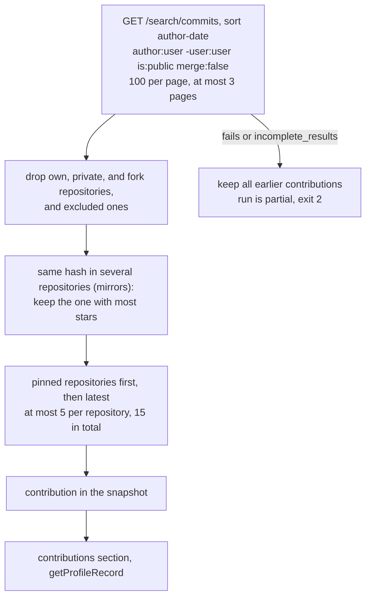

# M8.1 plan: GitHub contributions

- **Status:** Done (2026-10-30). Plan and implementation approved by the developer; manual checks pass.
- **Roadmap:** [M8.1](../ROADMAP.md#m81--github-contributions). Builds on the
  [M8](m8-github-source-adapter.md) and [M9](m9-refresh-pipeline-and-versions.md) plans.

## Objective

Show work outside the owner's own repositories, backed by **commits GitHub attributes to them on
the default branch of someone else's public repository**. Each becomes a cited, `source-observed`
`contribution` record. It does not show the commit's size or importance, or a role in the project.

Commits replace the roadmap's "merged pull requests": some projects take changes through their own
review system, or through direct commits, so no merged PR exists on GitHub. Merged PRs usually land
as commits on the default branch too.

## What the API shows

From a live check of the commit search on 2026-10-30:

- Each result has `repository.private`, `repository.fork`, and `repository.description`, but no
  license or stars.
- Mirrors exist that are not flagged as forks: the same commit hash appears in several repositories.
- Active repositories dominate the results, so limits per repository are needed.
- A pinned or forked repository has no commits by the owner in many cases, so it is no evidence.
- An organization can refuse a fine-grained token on `GET /repos` (403) for a public repository that
  answers without a token. Commit search with such a token is a manual check.

## Design

- **Record:** `Contribution` in core, source-neutral: `id`
  (`github.com/<owner>/<name>/commit/<full hash>`), `title` (first line of the message), `url`,
  `repositoryId`, `repository`, `repositoryUrl`, `repositoryDescription?`, `authored` (month),
  `provenance`. The source-key limit goes from 160 to 200.
- **Never stored:** the author's name and email from the commit, the rest of the message, change
  sizes, stars, counts. A count would change the profile with every commit and invite size claims.
- **Public check:** the query says `is:public`, and the code also drops any result whose own
  `private` flag is not `false`. No per-repository request is needed, so an organization's token
  policy does not matter here, if search itself still returns those commits.
- **Mirrors:** only for a hash found in several repositories, one `GET /repos/{owner}/{name}` each
  compares `stargazers_count` (used to choose, not stored). A failed lookup counts as 0 stars; ties
  go alphabetically, so the result is stable.
- **Forks are not used:** a fork is dropped, and its upstream repository is found by the search anyway.
  Pins only rank results.
- **Snapshot:** a `contributions` array with `retrievedAt` per entry, `[]` by default, still format
  version 2. The status file gains `contributionsKept`. Requests run after the repositories, and a
  search failure never fails the run unless there is no earlier snapshot.
- **Owner control:** optional `excludeContributionsTo: ["owner/name"]`, because anyone can write a
  commit with someone else's email. A project with the id `github.com/<owner>/<name>` is the owner's
  notes for all contributions to that repository.
- **Assistant:** a `contributions` section, lookup by id, and a prompt rule: GitHub attributes this
  commit to {name} by its author data; it does not show size, importance, or role, and the list is
  recent only, so "not listed" is not "never contributed". Titles are untrusted: cleaned, capped at
  200 characters, only in tool results.

**Known limits:** 300 commits are read, so a very active repository can push older work elsewhere out
of reach. Commits whose email is not linked to the account are not found. Only default branches are
searched. Commit headlines say less than PR titles. A new commit in an active repository makes
prepared answers stale (answered live).

**Out:** merged PRs as records, forks or pins with no commits, issues, reviews, change sizes, retries,
and the "open-source"/"by" wording (M11).

**Dependencies:** none new. Checked in GitHub's [search API](https://docs.github.com/en/rest/search/search)
and [commit qualifier](https://docs.github.com/en/search-github/searching-on-github/searching-commits)
docs: default branch only, `merge:false`, `is:public`, `sort=author-date`, 10 searches per minute
without a token and 30 with one. `-user:` is not named there but worked live; the code filters owners
too. The fetcher's budget check already ignores the `search` rate-limit resource.

## Files

`packages/core` (types, schema, observed, load, query), `packages/source-github` (new
`contributions.ts`; fetch, snapshot, config, normalize, carry-forward, fixtures), `packages/ai`
(tools, prompt), `apps/portfolio` (refresh, status, regenerated example answers), ADR 0011, an update
note on ADR 0009, roadmap (M8.1 wording), architecture, a new learning note
`contributions-and-evidence.md`, and updates to the related notes.

## Acceptance

Tests, with no network:

1. Filtering and caps: own, private, fork, and excluded repositories dropped; 5 per repository, 15 in
   total; pinned first.
2. Mirrors: the same hash in two repositories keeps the one with most stars; a failed lookup and a tie
   are stable; no lookup without duplicates.
3. Pages: stops at the last page, at most 3. A search failure or `incomplete_results` keeps earlier
   entries with their dates (exit 2); with no earlier snapshot the run fails; own repositories still
   update.
4. Merge, id conflicts, owner notes, and old snapshots reading as `[]`.
5. Tool section and lookup, the prompt rule, the citation gate, and injection text as a plain field.
6. No token, response body, or commit author email in any output or file. A rerun leaves the snapshot
   byte-identical.

Manual, with approval, on a local test profile: `refresh` with and without a token finds commits in
other owners' repositories and not their mirrors; one or two model calls to check the wording; regenerate the example answers (about 10 to
15 model calls, since the tools and prompt change). `pnpm verify` passes.

## Decisions

| # | Question | Recommended default | Alternative |
| - | -------- | ------------------- | ----------- |
| 1 | Limits | 5 per repository, 15 in total, 3 pages read | Other limits |
| 2 | Mirrors | Keep the repository with most stars | Keep all (the same commit twice, and the mirror looks like a project) |
| 3 | Which commits per repository | The latest | Oldest (no churn, but stale) |
| 4 | Pins and forks without commits | No record | A "pinned" record (invites implied involvement) |
| 5 | ADR | ADR 0011 | Update notes only |

## Review results

Recorded 2026-10-30. **Automated:** `pnpm verify` passes: lint, typecheck, 411 tests (`core` 74,
`source-github` 119, `ai` 116, app 102; 351 before), and the build, with the same two warnings as
before. No test uses the network or a model.

**Small additions to the plan:** a new `incomplete` error kind; a warning when a star lookup fails; a
commit linked to another account, or to none, is dropped in code too; the pinned-repository warning
now appears only when no commits were found there.

**Manual GitHub checks** (2026-10-30, a local test profile with a public account that has commits in
other owners' repositories and a mirror of some of them; no model calls):

| Check | Result |
| ----- | ------ |
| `refresh` without a token | Pass: 29 requests, exit 0, commits in other owners' repositories kept, the mirror's copies dropped, the cap of 5 per repository applied |
| `refresh` with a token whose fine-grained rules an organization refuses | Pass: the same contributions, so that organization's policy does not affect commit search; 30 requests, exit 0 |
| Rerun | Pass: snapshot byte-identical, `snapshotWritten: false` |
| Snapshot contents | Pass: no email, no `@`, no star counts |

**Observation:** the two token tiers give different profile versions, because pinned repositories
change the order of records, and order is content. Refresh with the same tier every time, or prepared
answers go stale without any change on GitHub.

**Model checks** (2026-10-30, `gemini-3.5-flash-lite`, about 25 calls, more than the planned 15):

- **Wording, through `handleChatRequest`:** contributions are attributed to public GitHub data, each
  cites its id, sizes are not claimed, and a question about repositories with no commits says that this
  is not available. Not repeated after the last prompt rule below.
- **Example answers:** the first regeneration accepted 2 of 5, and one accepted answer was **false**: it
  said the example profile has no open-source work, although a project is described as open source. The
  citation gate cannot catch this, because the answer cites nothing. The second regeneration, after the
  rule below, accepted 5 of 5, and all were read and are correct. One regeneration of a
  non-deterministic model is not proof that the rule always works.

**Two prompt rules added beyond the plan:**

- One pair of brackets per id, and record ids only: the model wrote several ids in one bracket, and
  cited a source id, which the citation gate rejects as designed. It can still happen, and then that
  starter is answered live.
- Projects, repositories, and contributions are separate sections, so check all three before saying
  there is none: this fixes the false answer above, which the new empty sections made more likely.

**Not done:** prepared answers of local test profiles are stale until their owner reruns the command.
