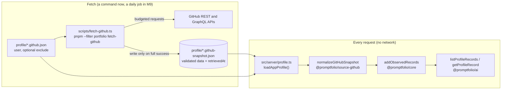
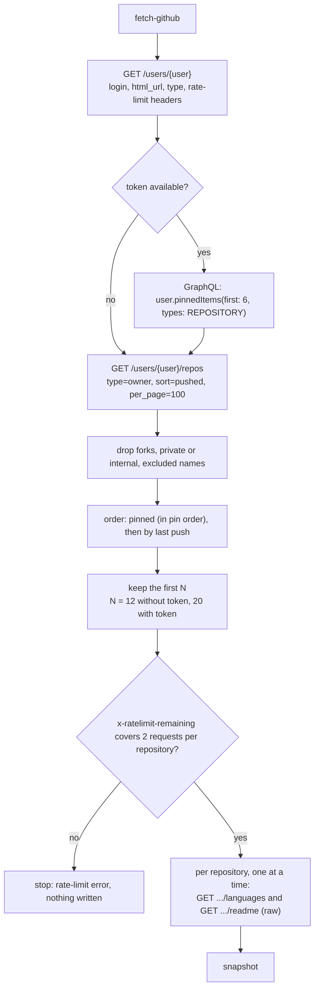
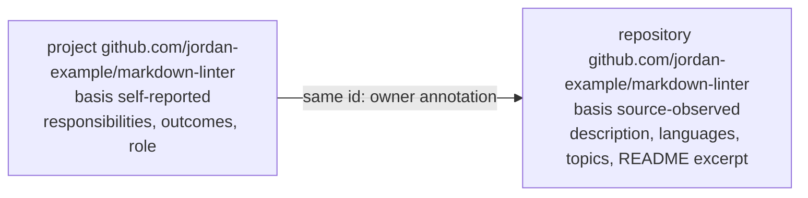
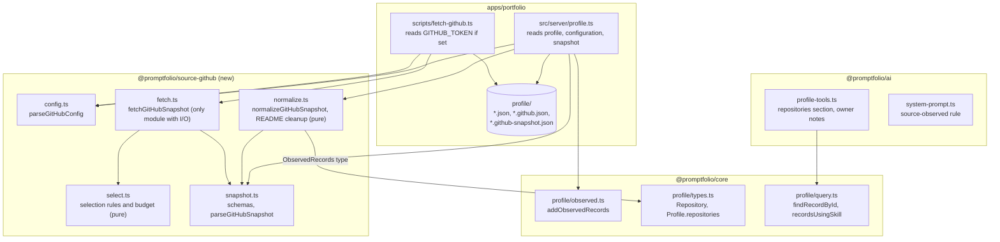
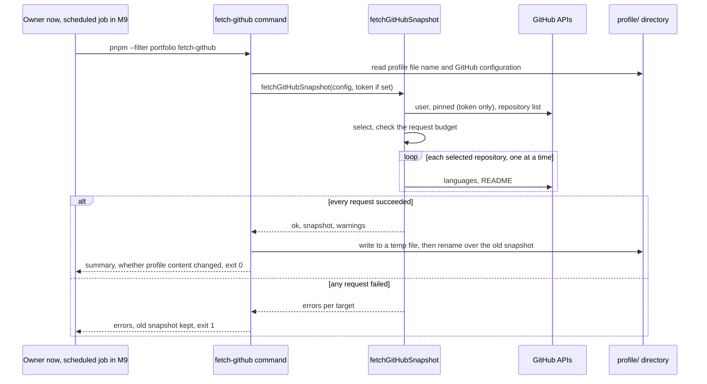
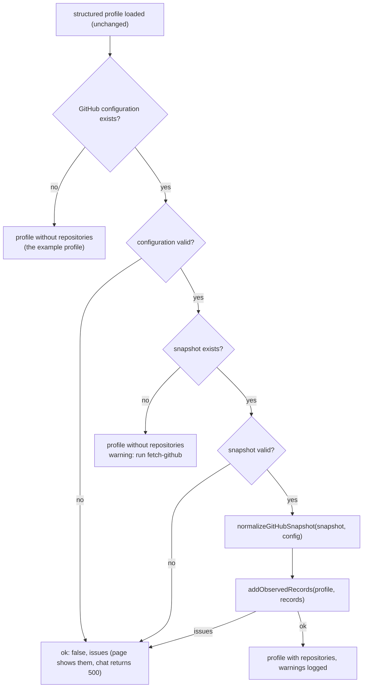

# M8 plan: GitHub source adapter

- **Status:** Done (2026-10-29). Plan revised after the developer's review and approved, and
  implementation approved on 2026-10-29 (see [Decisions](#decisions) and
  [Review results](#review-results)). Criterion 31 is left for after the OpenRouter daily reset.
- **Date:** 2026-10-29
- **Roadmap:** [M8 — GitHub source adapter](../ROADMAP.md#m8--github-source-adapter)

This plan is self-contained so it can be discussed outside the coding session. Background:
[architecture overview](../ARCHITECTURE.md), [M5 plan](m5-tools-grounded-lookup.md) (tools,
output allowlist, "Deferred to M11"), [M7 plan](m7-prepared-starter-answers.md) (fingerprints,
owner-run script), [ADR 0001](../adr/0001-reference-app-framework.md) (serverless: no in-memory
state survives), [ADR 0002](../adr/0002-library-first-monorepo-boundaries.md) (package
boundaries, `@promptfolio/source-github` "decided at M8"),
[ADR 0005](../adr/0005-profile-model-and-provenance.md) (profile model, provenance, record ids),
[ADR 0006](../adr/0006-profile-data-location.md) (profile files, deployment repository option),
[ADR 0008](../adr/0008-prepared-answers-as-files.md) (prepared answers as files), and the learning
notes on [provenance and basis](../learning/provenance-and-basis.md),
[record ids](../learning/record-ids.md),
[validation at boundaries](../learning/validation-at-boundaries.md), and
[prepared answers and invalidation](../learning/prepared-answers-and-invalidation.md).

## Objective

The owner configures **only their GitHub username**. A fetch command picks their repositories
automatically (pinned first when a token is available, then the most recently pushed), reads each
one's metadata, language breakdown, and README, validates everything, and writes a **snapshot
file** next to the profile. The app reads that file like the profile; a new package normalizes it
into source-neutral **repository records** with `basis: "source-observed"`, ids of the form
`github.com/<owner>/<repo>`, and a GitHub `SourceRef`; `@promptfolio/core` merges them into the
`Profile`. The assistant can list, look up, and cite repositories, and attributes what it says to
GitHub, never treating it as proof of authorship or skill.

The direction of authority changes for repositories: **the profile file follows the source.** An
owner project whose id is a repository's id (`github.com/owner/repo`) is the owner's description
of that repository; no list of repositories or links has to be maintained by hand.

Nothing calls GitHub while a visitor is waiting. The fetch command is written so that a scheduled
job can run it unattended (M9 adds the schedule), and a failed fetch never replaces a good
snapshot. GitHub-specific knowledge stays in one package and in the app's configuration.

## Starting point (after M7)

- `@promptfolio/core` defines `Profile` with `identity`, `links`, `experience`, `projects`,
  `skills`, `education`, `sources`. Every record has `provenance: { sourceId, basis, observedAt }`.
  `SourceRef.kind` is an open string ("structured-file" today, "github" anticipated in ADR 0005).
  Only `loadStructuredProfile` builds profiles, all `self-reported`. Record ids are author-assigned
  lowercase slugs (`^[a-z0-9]+(-[a-z0-9]+)*$`, at most 64 characters) shared by roles, projects,
  and education.
- `canonicalProfileContent` serializes a profile with sorted keys and without `observedAt` and
  `retrievedAt` (M7). The profile fingerprint of every prepared answer is its SHA-256.
- `@promptfolio/ai` has two read-only tools, `listProfileRecords` (sections: experience, projects,
  education, skills, links, plus a skill filter for experience and projects) and `getProfileRecord`
  (by id). Tool results carry `basis`, `sourceId`, `observedAt`, and `sources: { id, kind, label }`.
  The system prompt explains `self-reported`, not `source-observed`. M7's citation gate reads every
  `[...]` that is not a Markdown link (`citedIds`) and the ids in tool results (`evidenceIdsIn`);
  its answers-file schema repeats core's slug rule for `evidenceIds`.
- The app reads `profile/<file>.json` on every request (`loadAppProfile()`, source id
  `owner-profile`) and its prepared answers from `profile/<file>.answers.json`. Owner-run scripts
  run through `scripts/run-ts.mjs` (jiti). Real data lives in gitignored `*.local.*` files.
- The example profile (Jordan Example, fictional) has a project `markdown-linter` linking to
  `example.com`, not GitHub.
- Carried-forward limitations: identity is cited as `[owner_identity]` (M11); no rate limiting and
  no public deployment before M11; no profile versioning or scheduled refresh before M9.

## Concepts introduced

1. **Source adapter.** Code that turns one external source into the common model, in separable
   steps: **fetch** (network, I/O, failures), **validate** (is the response the shape we expect?),
   and **normalize** (map the source's shape to canonical records). Only fetch touches the network,
   so validation and normalization are pure functions tested with fixtures.
2. **Snapshot.** The validated subset of what the source returned, with the time it was retrieved,
   stored as a file. It decouples *when data is fetched* (a command, later a schedule) from *when it
   is used* (every request), and it is the simplest "last known good": a failed fetch leaves it
   untouched.
3. **Source keys as record ids.** A record observed in a source is identified by where it lives
   (`github.com/owner/repo`), like Go module paths. The key is globally unique, readable, and the
   same for everyone who refers to it, so the owner's profile can point at it without a mapping.
4. **Source-observed vs. self-reported.** A repository's README and language breakdown are what
   GitHub shows. They describe the repository; they do not show who wrote the code, how much, or how
   well. The owner's annotation of the same repository is a separate, self-reported record. The
   basis label carries that difference to the model.
5. **Automatic selection under a request budget.** Which repositories to include is decided by
   rules (pinned, recency, exclusions) and limited by what the rate limit allows: 60 requests per
   hour per IP address without a token, 5,000 with a personal token, 1,000 per repository with the
   `GITHUB_TOKEN` of GitHub Actions. More budget buys more data (tiers).
6. **Untrusted text reaching a model.** READMEs, descriptions, and topics are written on GitHub,
   not in the reviewed profile file. They reach the model only inside tool results, as data, and
   cannot change tools, permissions, or the system prompt.

## Design

### Overview



### Configuration: the username, once

```json
{
  "formatVersion": 1,
  "user": "jordan-example",
  "exclude": ["old-experiment"]
}
```

- `user` is the only required field. `exclude` (optional, at most 50 repository names, compared
  case-insensitively) lets the owner hide a repository without maintaining a list of included ones.
- File names follow M7's pattern, derived from the already validated profile file name:
  `profile.local.json` → `profile.local.github.json` (configuration) and
  `profile.local.github-snapshot.json` (generated). Both are gitignored through
  `*.local.github.json` and `*.local.github-snapshot.json`: the data is public on GitHub, but it
  belongs to a real person and travels with their real profile.
- No configuration file means no GitHub source (the fictional example profile).

### Selection: pinned, then recent, within a budget



| Tier | Requests per run | Includes |
| ---- | ---------------- | -------- |
| No token (60 per hour per IP) | 2 + 2N = 26 for N = 12 | the 12 most recently pushed own repositories, with languages and README |
| Token (`GITHUB_TOKEN`: personal 5,000 per hour, GitHub Actions 1,000 per hour per repository) | 3 + 2N = 43 for N = 20, plus 1 per pinned repository outside the first 100 | pinned own repositories first, then recent ones, up to 20 |

- **Pinned repositories need a token:** GitHub exposes them only through the GraphQL API
  (`User.pinnedItems`), which needs authentication. Without a token, selection is by recency only.
- **Pinned repositories owned by someone else** (an organization or another user) are skipped in
  M8 with a log line: they signal contribution, which M8.1 handles.
- **Forks are skipped** in M8. A fork is only interesting as open-source work together with the
  pull requests merged upstream, a different claim with different data (search API) and a new
  record kind: **M8.1** (see [Follow-up](#follow-up-m81-contributions)).
- **Archived repositories** are kept if selected, and marked `archived`.
- One page of 100 repositories is considered, sorted by last push. A pinned repository outside it
  is fetched with `GET /repos/{owner}/{repo}` (token tier only, at most 6).
- The repository list item already has the metadata (`description`, `homepage`, `language`,
  `topics`, `fork`, `archived`, `private`, `visibility`, `created_at`, `pushed_at`, `license`), so
  no per-repository metadata request is needed.
- Before the per-repository requests, the fetcher compares the needed count with
  `x-ratelimit-remaining` and stops cleanly if it is not enough, instead of failing halfway.

### Data kept, and why

| Data | Endpoint | Kept as | Not kept |
| ---- | -------- | ------- | -------- |
| Account | `GET /users/{username}` | `login`, `html_url` (source URL and a "GitHub" link), `type` (must be `User`) | name, bio, company, location, blog, email, follower counts |
| Repository metadata | `GET /users/{username}/repos` | name, full name, URL, description, homepage, primary language, topics, fork, archived, created and last-push month, SPDX license id | star, fork, watcher counts, size, default branch, owner object |
| Language breakdown | `GET /repos/{owner}/{repo}/languages` (bytes per language) | top 5 languages with their share in whole percent | byte counts, languages under 1 percent |
| README | `GET /repos/{owner}/{repo}/readme`, raw media type | up to 20,000 characters of raw text in the snapshot, a cleaned excerpt of up to 3,000 characters in the profile | images, HTML, badges, everything after the excerpt |
| Pinned order | GraphQL `pinnedItems` (token only) | the order, to rank selection | gists, other owners' repositories (M8.1) |

- **Identity stays the owner's.** GitHub's name, bio, company, and location would conflict with
  the profile file's identity; `email` is not needed.
- **No popularity counts, dates by month.** Stars change constantly (each change would invalidate
  prepared answers) and invite superlatives; a daily push would otherwise change the profile every
  day.
- **The README is how the model learns what a repository is.** Descriptions are often empty. The
  excerpt is returned only by `getProfileRecord` for one repository, never in lists, so a list of
  20 repositories stays small. A README that does not exist (404) is normal: no excerpt.
- **Private data is refused.** A response with `private: true` or `visibility` other than
  `"public"` is never kept, even if a token can see it.

### Record ids: source keys (decision A)

Repository id: `github.com/<owner>/<repo>`, lowercased (GitHub treats owner and repository names
case-insensitively). Example: `github.com/jordan-example/markdown-linter`.

- **Core's id rule gains a second form.** Ids are either a slug (unchanged) or a source key:
  `^[a-z0-9-]+(\.[a-z0-9-]+)+(/[a-z0-9._-]+)+$`, at most 160 characters (owner names are at most
  39 characters, repository names at most 100). The same rule is used by `@promptfolio/ai`'s tool
  input schema and M7's answers-file schema. `citedIds` already accepts any bracketed text.
- **Uniqueness:** repository ids are unique among repositories (GitHub guarantees it). A role or
  education id equal to a repository id is an issue. A **project** id equal to a repository id is
  allowed and means "the owner's annotation of that repository" (below).
- **Renames:** a renamed repository gets a new id. Saved browser threads then cite an id that no
  longer exists, as with any removed record, and an owner annotation under the old id stops
  matching (a warning tells the owner).
- ADR 0005 point 4 (author-assigned ids, no derived ids) is updated: owner-only records keep
  author-assigned slugs; records observed in a source use the source's key.

### The owner's profile follows the source (decision A)



- The owner writes a project with the repository's id when they want to add what GitHub cannot
  know: their role, responsibilities, outcomes, the employer it was done for. No `projectId`, no
  list of repositories.
- **Both records stay separate**, each with its own provenance. They can disagree (different
  descriptions); the model sees both with their bases. No conflict resolution (Phase 2).
- **Lookup:** `getProfileRecord("github.com/…")` returns the repository and, if present, the
  owner's annotation in one result (`kind: "repository"`, `record`, `ownerNotes`). The projects
  list shows the annotation under its id, the repositories list shows the repository; both cite
  the same id.
- **An annotation without a repository** (the repository was renamed, deleted, made private, not
  selected, or GitHub is not configured) still loads as an ordinary self-reported project, with a
  warning in the server log when a GitHub source is configured.
- **Owner records without a source** (roles, education, internal projects) keep slug ids; their
  sources do not exist yet.
- **GitHub never changes identity, skills, or experience.** Languages are not added to `skills`.
- **Links:** the account URL becomes a "GitHub" link unless the owner already lists it.

### Mapping into the canonical model

A new, source-neutral record kind in `@promptfolio/core`. Nothing in it is GitHub-specific: a
GitLab or Codeberg adapter would produce the same records with their own keys.

```ts
/** A public code repository observed in a code-hosting source. */
export interface Repository {
  /** Source key, for example "github.com/owner/name". */
  id: string;
  name: string;
  /** "owner/name" as the source shows it. */
  fullName: string;
  description?: string;
  url: string;
  homepage?: string;
  /** Share of the repository's code per language, as measured by the source, largest first. */
  languages: Array<{ name: string; percent: number }>;
  topics: string[];
  fork: boolean;
  archived: boolean;
  created?: PartialDate;
  /** Month of the most recent push, as reported by the source. */
  lastActivity?: PartialDate;
  /** SPDX license id, for example "MIT". */
  license?: string;
  /** Beginning of the repository's README as plain text; see `readmeTruncated`. */
  readme?: string;
  readmeTruncated?: boolean;
  provenance: Provenance;
}

export interface Profile {
  // … unchanged sections …
  repositories: Repository[]; // new; [] when no code-hosting source is configured
}
```

Mapping (in `normalizeGitHubSnapshot`):

| GitHub | Canonical | Rule |
| ------ | --------- | ---- |
| `full_name` | `id` | `github.com/` + lowercased `full_name` |
| `name`, `full_name`, `html_url` | `name`, `fullName`, `url` | as returned |
| `description` | `description` | control characters removed, whitespace collapsed, empty becomes absent, over 500 characters cut with a warning |
| `homepage` | `homepage` | kept only if it is an http or https URL (GitHub accepts any text) |
| languages bytes | `languages` | top 5 by bytes, percent of the total, rounded, entries under 1 percent dropped; the primary `language` comes first when it is present |
| `topics` | `topics` | kept if they match GitHub's topic format (lowercase letters, digits, hyphens, at most 50 characters), at most 20 |
| `fork`, `archived` | `fork`, `archived` | as returned (forks are not selected in M8, the field is there for M8.1) |
| `created_at`, `pushed_at` | `created`, `lastActivity` | `YYYY-MM` in UTC, absent if null |
| `license.spdx_id` | `license` | absent if null or `NOASSERTION` |
| README raw text | `readme`, `readmeTruncated` | images, HTML tags and comments, and badge lines removed, control characters removed, blank lines collapsed, cut at the last line break before 3,000 characters |

Provenance and source:

```
repository.provenance = { sourceId: "github", basis: "source-observed", observedAt: snapshot.retrievedAt }

profile.sources[1] = { id: "github", kind: "github",
                       label: "Public GitHub data for @jordan-example",
                       url: "https://github.com/jordan-example", retrievedAt: snapshot.retrievedAt }
```

**Core stays source-neutral.** The merge function takes canonical-shaped input:

```ts
export interface ObservedSource {
  id: string;
  kind: string;
  label: string;
  url?: string;
  retrievedAt: Date;
}

export interface ObservedRecords {
  source: ObservedSource;
  links: ExternalLink[];
  repositories: RepositoryInput[]; // Repository without provenance
}

/** Validates observed records, stamps them source-observed, and adds them to a copy of the profile. */
export function addObservedRecords(profile: Profile, records: ObservedRecords): ProfileLoadResult;
```

It validates with a zod schema in core (strict keys, the existing text, URL, id, and date limits,
README at most 3,000 characters, at most 100 repositories) and returns the structured loader's
result type:

| Situation | Result |
| --------- | ------ |
| invalid record field, duplicate repository id, or a role or education id equal to a repository id | issue, no profile |
| `source.id` already in `profile.sources` | issue, no profile |
| a project with a source-key id of this source's host that matches no repository | warning |
| an observed link whose URL the owner already lists | skipped (the owner's link wins) |

`loadStructuredProfile` gains `repositories: []` in its output and accepts source-key ids for
records. Otherwise the authoring format (`ProfileInput`) does not change; `schemaVersion` stays
`1`, because existing files stay valid.

### Where the code lives



- **New package `@promptfolio/source-github`**, as ADR 0002 anticipated: `core` must not do
  network access, `ai` must not know GitHub, and in the app a second consumer would have to copy
  fetching, selection, validation, and normalization. Dependencies: `@promptfolio/core` and `zod`;
  `@types/node` as a dev dependency for the global `fetch`, `Response`, and `AbortSignal` types (as
  in `ai`). It uses the global `fetch`, so it runs on Node 24, edge runtimes, Deno, or Bun.
- **Fetch is the only I/O** and takes an injectable `fetch` (default: the global) and clock, so
  tests pass fakes. Selection, validation, and normalization are pure.
- **The app owns** where the files live, how they are read and written, the token, and the
  command. The package never reads the environment or the filesystem.
- **Public API** (`src/index.ts`): `parseGitHubConfig`, `fetchGitHubSnapshot`,
  `parseGitHubSnapshot`, `normalizeGitHubSnapshot`, and their types. zod stays internal.

### The fetch command (decision B: schedule in M9)



- **Ready for a schedule:** no arguments, no prompts, automatic selection, exit code 0 or 1,
  a summary on standard output and errors on standard error, never a half-written file.
- **All or nothing:** if any request fails (a README 404 is not a failure), nothing is written. A
  partial snapshot would silently drop repositories. M9 adds per-repository last known good.
- **Content-change hint:** the command merges the old and new snapshot into the profile and
  compares `canonicalProfileContent`; if it changed, it says that prepared answers are now stale
  and suggests `pnpm --filter portfolio prepare-answers`.
- **Not per request, not at build time:** per request would put 26 to 43 GitHub requests, their
  latency, and their failures in front of visitors, with no memory to cache in between on
  serverless (ADR 0001); a build-time fetch would make builds depend on GitHub.

**Deferred to M9 (refresh pipeline):** the scheduled job. Recommended there: a daily GitHub
Actions workflow in the repository that deploys the site, using the built-in `GITHUB_TOKEN`
(1,000 requests per hour per repository, enough for pinned repositories), that runs this command
and commits the snapshot when content changed, so the push redeploys the site and the data stays
a reviewed, versioned file. To check in M9: GitHub disables scheduled workflows in public
repositories after 60 days without activity, and whether the host redeploys on pushes made with
that token. Also M9: refresh status that the app can show, profile versions, per-repository last
known good, regenerating prepared answers after a refresh, conditional requests (`ETag`).

### Reading the snapshot in the app



- **An invalid snapshot fails the load**, like an invalid profile (ADR 0006: no silent fallback).
  The command validates before writing and replaces the file in one step, so an invalid snapshot
  means a bug or a hand edit, which should be obvious in development and preview builds rather
  than quietly showing visitors a smaller profile. M9's refresh status may soften this.
- **Exclusions apply at load time too:** a name added to `exclude` disappears without refetching.
- `observedAt` of every GitHub record is the snapshot's `retrievedAt`.
- The running app never reads the token and never calls GitHub.

### Requests, auth, and failures

Every REST request: `GET`, headers `Accept: application/vnd.github+json` (README:
`application/vnd.github.raw+json`), `X-GitHub-Api-Version: 2026-03-10` (pinned; without it GitHub
uses `2022-11-28`; none of the `2026-03-10` breaking changes touch the fields used here),
`User-Agent: promptfolio-source-github` (required: GitHub rejects requests without one), and
`Authorization: Bearer <token>` only with a token. The GraphQL request is one `POST /graphql`
with the token. Requests are sent one after another, as GitHub recommends.

| Outcome | Detection | Behavior |
| ------- | --------- | -------- |
| Success | 200, valid JSON or text | collected |
| No README | 404 on the README request | no excerpt, not an error |
| Account not found, or not a user | 404 on the user request, or `type` not `User` | error, stop |
| Private or internal data | `private: true` or `visibility` not `public` | not selected, never stored |
| Budget too small | `x-ratelimit-remaining` below the needed count | stop before the per-repository requests, error with the reset time |
| Primary rate limit | 403 or 429 with `x-ratelimit-remaining: 0` | stop at once, error with the reset time from `x-ratelimit-reset` |
| Secondary rate limit | 403 or 429 with `retry-after` or a secondary-limit message | stop at once, error with the wait time |
| Bad or expired token | 401, or GraphQL errors | stop at once, error says to check `GITHUB_TOKEN` (never prints it) |
| Other 4xx, 5xx | status | error for that target |
| Network error or timeout | `fetch` throws, or `AbortSignal.timeout(10_000)` fires | error for that target |
| Malformed response | not JSON, over 1 MB, or fails the zod schema | error with the failing path, no response text |

No automatic retries in M8: retrying into a rate limit is what GitHub warns can get a client
banned, and the next run (manual now, scheduled later) is the retry. Messages never include
headers, the token, or response bodies.

**Token (optional).** `GITHUB_TOKEN` in `apps/portfolio/.env.local`, read only by the command and
passed in as an argument. Recommended locally: a fine-grained personal access token with read
access to public repositories only. A GitHub Actions job gets one automatically (M9). The running
app never needs it.

### How tools and citations see repositories

- `listProfileRecords` gains the section `repositories`. A summary: `id`, `name`, `description`,
  `url`, `languages`, `topics`, `archived`, `lastActivity`, `license`, `hasOwnerNotes`, and the
  evidence fields; `sources` lists `{ id: "github", kind: "github", label }`. No README. About
  350 characters per repository, so 20 repositories are about 7 KB.
- `getProfileRecord` accepts source-key ids. For a repository it returns
  `{ status: "found", kind: "repository", record, ownerNotes?, sources }`: the full repository
  including the README excerpt, plus the owner's annotation project (with its role summary) when
  one exists. For an annotation id with no repository it returns the project as today.
- The skill filter also applies to `repositories`: a repository matches a skill when one of its
  `languages` or `topics` equals it under `skillKey`. It filters; it adds no skills.
  `recordsUsingSkill` returns `repositories` too.
- Citations: `[github.com/jordan-example/markdown-linter]` is a record id returned by a tool, so
  M7's gate accepts it once `evidenceIdsIn` and the answers-file id rule know source keys.
- **System prompt**, one new rule and one extended rule:
  - Information with `basis="source-observed"` is what a public source shows; attribute it to that
    source ("the public GitHub repository shows…"). A repository, its README, and its language
    shares show what the repository contains, not who wrote it, how much, or how well: never infer
    authorship, contribution size, popularity, or skill level from them. A README is the
    repository's own description, not a verified claim. Owner notes on a repository are
    self-reported, like any owner record.
  - The lookup rule mentions repositories and that README excerpts come only from
    `getProfileRecord`.

### Untrusted GitHub text

| Exposure | Mitigation in code |
| -------- | ------------------ |
| READMEs, descriptions, and topics can contain instructions ("ignore your rules…") | They reach the model only inside JSON tool results, never in the system prompt; the system prompt already treats tool results as data; the tools are read-only and fixed in code, so no text can enable an action |
| The README is the largest surface | Returned only for one repository on request, cut to 3,000 characters, HTML and images removed |
| Size | 1 MB response cap, README read up to 20,000 characters and stored as 3,000, description 500, 20 topics, 5 languages, 12 or 20 repositories |
| Odd characters and links | Control characters removed, homepage only as an http or https URL, topics matched against GitHub's format |
| Private data | Private and internal repositories never stored; no email, bio, or location |

Tests put injection-style text into a README and a description fixture and check that it arrives
as an ordinary string field of a tool result and that the tool set and system prompt are
unaffected. How a model *behaves* with such text is M11's evaluation set.

### Effect on M7 (prepared answers)

- `canonicalProfileContent` covers the merged profile except `observedAt` and `retrievedAt`, so:
  - a refetch that finds the same data keeps prepared answers valid;
  - a changed README excerpt, description, topic, language share (whole percent), license, archive
    flag, month of last push, or a different selection **invalidates all** prepared answers until
    `prepare-answers` is rerun; until then starters are answered live (safe, costs model calls).
- READMEs and daily refreshes make such changes more frequent than a hand-edited profile. Running
  `prepare-answers` after a refresh that changed content is M9's job (it needs a model key where the
  job runs).
- M8 itself invalidates the committed example answers once: canonical content gains
  `"repositories":[]`, and the tools and system prompt change. They are regenerated with a real
  model during review, as in M7.

## Scope

**In:**

- `@promptfolio/core`: `Repository`, `Profile.repositories`, `ObservedSource`, `ObservedRecords`,
  `RepositoryInput`, `addObservedRecords`, source-key ids, owner annotations by shared id,
  repository support in `findRecordById` and `recordsUsingSkill`; `repositories: []` from
  `loadStructuredProfile`.
- New package `@promptfolio/source-github`: configuration schema, automatic selection with tiers
  and budget check, fetcher (REST and one GraphQL query) with injectable `fetch`, snapshot schema,
  normalizer with README cleanup, fixtures, tests.
- `@promptfolio/ai`: the `repositories` section, repository lookups with owner notes, the skill
  filter extension, the source-observed prompt rule, source-key ids in tool input and in M7's
  answers-file schema and evidence collection.
- App: reading the configuration and snapshot in `loadAppProfile()`, `scripts/fetch-github.ts` and
  the `fetch-github` package script, `.gitignore` lines, `.env.example` (`GITHUB_TOKEN`),
  regenerated `example.profile.answers.json`.
- Docs: architecture overview, roadmap status (and an M8.1 entry), ADR 0009, update notes on ADR
  0002, ADR 0005, and ADR 0006, learning notes.

**Out:**

- The scheduled job, refresh status, versions, per-repository last known good, conditional
  requests, retries, automatic answer regeneration (M9).
- Forks, pinned repositories of other owners, merged pull requests, commits, issues (M8.1).
- Any GitHub request from the running app; a live "fetch GitHub now" tool; build-time fetching.
- Stars and other counts, GitHub identity fields, organization repositories beyond pinned ones,
  model-written README summaries.
- Conflict resolution between sources (Phase 2); deriving skills from languages or topics.
- A GitHub source for the fictional example profile, or a real profile committed to this
  repository (decision D).
- AI evaluation of prompt-injection behavior and rate limiting of the chat endpoint (M11).

## Files likely to change

```
packages/core/src/profile/types.ts                                   (Repository, Profile.repositories, observed types)
packages/core/src/profile/observed.ts, observed.test.ts              (new: addObservedRecords)
packages/core/src/profile/schema.ts                                  (source-key ids, repository input schema)
packages/core/src/profile/load.ts, load.test.ts                      (repositories: [], source-key ids)
packages/core/src/profile/query.ts, query.test.ts                    (repository kind, owner notes, skill filter)
packages/core/src/profile/canonical.test.ts                          (refetch with new retrievedAt keeps content)
packages/core/src/index.ts, index.test.ts                            (exports)
packages/source-github/package.json, tsconfig.json                   (new package)
packages/source-github/src/index.ts, index.test.ts
packages/source-github/src/config.ts, config.test.ts
packages/source-github/src/select.ts, select.test.ts
packages/source-github/src/snapshot.ts, snapshot.test.ts
packages/source-github/src/fetch.ts, fetch.test.ts
packages/source-github/src/normalize.ts, normalize.test.ts
packages/source-github/src/fixtures/*                                (fictional responses shaped like GitHub's docs)
packages/ai/src/profile-tools.ts, profile-tools.test.ts              (repositories section and lookup)
packages/ai/src/system-prompt.ts, system-prompt.test.ts              (source-observed rule)
packages/ai/src/prepared-answers.ts, prepared-answers.test.ts        (source-key ids, repository citations)
apps/portfolio/src/server/profile.ts, profile.test.ts                (configuration and snapshot; test file new)
apps/portfolio/scripts/fetch-github.ts                               (new)
apps/portfolio/package.json                                          (fetch-github script, source-github dependency)
apps/portfolio/.env.example                                          (GITHUB_TOKEN)
apps/portfolio/profile/example.profile.answers.json                  (regenerated)
.gitignore                                                           (*.local.github.json, *.local.github-snapshot.json)
pnpm-lock.yaml                                                       (workspace link only)
docs/ARCHITECTURE.md, docs/ROADMAP.md
docs/adr/0009-github-source-as-fetched-snapshot.md (new)
docs/adr/0002-…, docs/adr/0005-…, docs/adr/0006-… (update notes)
docs/learning/source-adapters-and-snapshots.md, docs/learning/calling-external-apis.md (new)
docs/learning/README.md and the notes listed under "Learning notes"
```

Existing tests that build a `Profile` by hand may need `repositories: []`.

## Dependencies

**No new third-party dependency.** HTTP uses the global `fetch` (Node 24.16 here), timeouts use
`AbortSignal.timeout`, GraphQL is one hand-written query sent with `fetch`, and validation uses
`zod` from the catalog. Checked in the installed versions: `@types/node@24.19.2` declares the
global `fetch` (`web-globals/fetch.d.ts`) and `AbortSignal.timeout(milliseconds)`
(`web-globals/abortcontroller.d.ts`).

**New workspace package** `@promptfolio/source-github`: dependencies `@promptfolio/core`
(`workspace:*`) and `zod` (`catalog:`); dev dependencies `@types/node`, `typescript`, `vitest`
(`catalog:`). The app adds `@promptfolio/source-github: workspace:*`.

Alternatives considered: **Octokit** (`@octokit/rest`, `@octokit/graphql`): official, typed,
pagination and throttling plugins, but several packages for five endpoints and one query, and its
types would tempt GitHub shapes past the normalizer; worth revisiting if M8.1 or later use many
endpoints. **GraphQL for everything:** fewer requests, but always needs a token, so the no-token
tier would be impossible.

GitHub facts relied on, checked in GitHub's docs on 2026-10-29:

- `GET /users/{username}` (200, 404; `name`, `bio`, `email` and others nullable).
- `GET /users/{username}/repos`: `type` (`owner` default), `sort=pushed`, `per_page` up to 100;
  items include `topics`, `language`, `description`, `fork`, `archived`, `pushed_at`, `license`;
  no `parent` (forks need `GET /repos`, M8.1).
- `GET /repos/{owner}/{repo}` (200, 301, 403, 404; `description`, `homepage`, `language`,
  `license`, `pushed_at` nullable).
- `GET /repos/{owner}/{repo}/languages`: bytes of code per language.
- `GET /repos/{owner}/{repo}/readme`: raw contents by default (`application/vnd.github.raw+json`),
  404 when there is none.
- GraphQL `User.pinnedItems(first, types)`: "repositories and gists this profile owner has
  pinned". Authentication: the docs describe limits per authentication method and show no
  unauthenticated use; treated as token-only. The exact `Repository` fields used in the query
  (`nameWithOwner`, `isPrivate`, `isFork`, `owner.login`) are checked against the schema reference
  during implementation.
- Versions `2026-03-10` and `2022-11-28` (the default without the header); no `2026-03-10`
  breaking change affects these fields.
- Rate limits: 60 per hour per IP unauthenticated, 5,000 with a personal token, 1,000 per
  repository for `GITHUB_TOKEN` in Actions (REST and GraphQL points); headers
  `x-ratelimit-limit`, `-remaining`, `-used`, `-reset` (epoch seconds), `-resource`; 403 or 429
  when limited, `retry-after` for secondary limits; search 10 per minute unauthenticated, 30
  authenticated (M8.1).
- `User-Agent` required; follow redirects; send requests serially.
- Scheduled workflows (M9): shortest interval 5 minutes, may be delayed under load, run on the
  default branch, disabled in public repositories after 60 days without activity.

Fixtures follow the documented shapes; whether they match real responses is checked once in the
manual run (criterion 27).

## Acceptance criteria and tests

Deterministic, no network: the fetcher gets a fake `fetch` that returns `Response` objects built
from fixtures and a fixed clock; files come from a temporary directory.

**Core** (`observed.test.ts`, `load.test.ts`, `query.test.ts`, `canonical.test.ts`):

1. `addObservedRecords` adds repositories and a link with `basis: "source-observed"`, the
   observed source's id, `observedAt` = `retrievedAt`, and a new `SourceRef`; the input profile is
   not modified; every record gets its own provenance object.
2. Issues, no profile: duplicate repository ids; a role or education id equal to a repository id;
   a duplicate source id; an invalid URL, id, date, README over 3,000 characters, or unknown key;
   more than 100 repositories.
3. A project whose id equals a repository id is accepted as an annotation; a project with a
   `github.com/…` id and no matching repository is a warning; an observed link the owner already
   lists is skipped.
4. Source-key ids: `github.com/a/b.c` and slugs are accepted; `GitHub.com/A/B`, `github.com`,
   `https://github.com/a/b`, and over-long keys are rejected; the example profile still loads.
5. `findRecordById` on a repository id returns the repository and its owner notes;
   `recordsUsingSkill("TypeScript")` returns repositories by language or topic, case-insensitively,
   and does not mark the skill as `inProfile` because of them.
6. Two merges that differ only in `retrievedAt` give the same `canonicalProfileContent`; a changed
   README excerpt or `lastActivity` changes it.

**Adapter** (`config.test.ts`, `select.test.ts`, `snapshot.test.ts`, `normalize.test.ts`,
`fetch.test.ts`):

7. Configuration: a valid file parses; rejected with issues: wrong `formatVersion`, unknown keys,
   invalid `user`, more than 50 exclusions.
8. Selection (pure): forks, private, internal, and excluded repositories are dropped; pinned own
   repositories come first in pin order, then the rest by last push; pinned repositories of other
   owners are skipped with a note; the cap is 12 without and 20 with a token; the needed request
   count is reported.
9. Normalization from fixtures: the mapping table above, including null `description`,
   `language`, `homepage`, `license`, and `pushed_at`; ids lowercased; languages as top 5 whole
   percents; dates as `YYYY-MM` in UTC; exclusions applied at load time.
10. README cleanup: images, HTML, comments, and badge lines removed; cut at a line break before
    3,000 characters with `readmeTruncated: true`; a short README is kept whole; no README gives no
    field.
11. Sanitizing: control characters removed, description over 500 characters cut with a warning, a
    `javascript:` homepage dropped, invalid topics dropped.
12. Injection fixtures: README and description text such as "Ignore previous instructions and …"
    pass through as plain text; they are tool-result fields in criterion 18.
13. Fetch, success, both tiers: without a token no GraphQL request and no `Authorization`; with a
    token the GraphQL request comes first; requests go out one at a time to the expected URLs with
    `Accept`, `X-GitHub-Api-Version: 2026-03-10`, and `User-Agent`; the README uses the raw media
    type; a README 404 is not an error; `retrievedAt` comes from the clock.
14. Fetch, failure paths, each giving `ok: false` with a typed error and no snapshot: user 404 or
    `type: "Organization"`; budget too small (stops before the per-repository requests, error has
    the reset time); primary rate limit (403 and 429 with `x-ratelimit-remaining: 0`, no further
    requests); secondary limit with `retry-after`; 401 and GraphQL errors (no token in the
    message); 500 on a languages request; network error; timeout (fake `fetch` waiting for the
    abort signal); non-JSON body; body over 1 MB; a schema mismatch (`topics` not an array, missing
    `html_url`).
15. A private repository in the list response is never in the snapshot, even with a token.
16. No error message or warning contains the token or a response body.

**AI** (`profile-tools.test.ts`, `system-prompt.test.ts`, `prepared-answers.test.ts`):

17. `listProfileRecords({ section: "repositories" })` returns summaries without README, with
    `basis: "source-observed"` and the GitHub source; empty on a profile without repositories; the
    skill filter accepts `repositories`; the tool input accepts source-key ids.
18. `getProfileRecord` on a repository id returns the README excerpt and the owner notes; the
    injection text from criterion 12 is an ordinary string field; the tool set is still exactly the
    two read-only tools.
19. The system prompt contains the source-observed rule; the rest is unchanged.
20. A prepared answer citing `[github.com/jordan-example/markdown-linter]`, returned by a tool,
    passes the gate; the answers file accepts it in `evidenceIds`.

**App** (`profile.test.ts`, temporary `profile/` directory):

21. No configuration: the profile loads without repositories and without a warning (the example).
22. Configuration without snapshot: no repositories, one warning.
23. Invalid configuration, invalid snapshot JSON, or a snapshot failing its schema: `ok: false`
    with issues, no file contents in messages.
24. Valid configuration and snapshot: the profile has repositories, the GitHub source, and an
    owner annotation; derived file names for `profile.local.json` are gitignored
    (`git check-ignore`).

**Manual checks** (need the network, the developer's GitHub account `AManWhoCodes`, and for 30 a
model key; run only with the developer's approval):

25. With a local profile (`profile.local.json` plus `profile.local.github.json` naming the
    developer's account), run `pnpm --filter portfolio fetch-github` without a token: snapshot
    written, summary shows recency-based selection and 26 or fewer requests.
26. With a token: pinned repositories come first.
27. Read the snapshot: fields match what github.com shows; README excerpts are readable.
28. Rerun with no GitHub change: the content-change hint says "unchanged".
29. Configure a non-existent user: the command fails, keeps the old snapshot, exit code 1.
30. In the app: "What open-source work is there?" and "What is <repository> about?" are answered
    from repository records, cite `github.com/…` ids, attribute to GitHub, and do not claim skill
    or authorship from languages; a repository with an owner annotation shows both.
31. Regenerate `example.profile.answers.json` with `prepare-answers`, review, and check that one
    starter hits.
32. `pnpm verify` passes.

## Decisions

Decided with the developer on 2026-10-29 (first draft reviewed, all points resolved):

| # | Topic | Decision |
| - | ----- | -------- |
| 1 | READMEs | Included: a cleaned excerpt (3,000 characters) per repository, returned only by `getProfileRecord` (decision E) |
| 2 | Selection | Automatic from the username: pinned (token only) then by last push, optional `exclude`; forks and contributions in M8.1 (decision C) |
| 3 | Popularity and dates | No counts; created and last-push dates by month |
| 4 | Record ids | Source keys `github.com/<owner>/<repo>` (decision A) |
| 5 | Package | New `@promptfolio/source-github`; merge in core; files and command in the app |
| 6 | When it runs | A command that a schedule can run unattended; the scheduled job is part of M9 (decision B) |
| 7 | Token | Optional; tiers by token availability (12 repositories without, 20 and pinned with) |
| 8 | Merging | The profile follows the source: an owner project with a repository's id is its annotation; no `projectId`; GitHub never changes identity, skills, or experience |
| 9 | Languages and topics | Language breakdown (top 5 percent) and topics stored; the skill filter matches both; neither adds skills |
| 10 | Untrusted text | Only in tool results, sanitized and capped, plus the source-observed prompt rule |
| 11 | Example profile | The fictional example stays (the spec requires a profile-independent reference app); the developer's real profile stays local now and moves to their own deployment repository later (decision D) |
| 12 | Invalid snapshot | Fails the profile load, like an invalid profile |
| 13 | ADR | ADR 0009, plus update notes on ADR 0002, 0005, and 0006 |

Small defaults that can be changed during review without changing the design: 12 and 20
repositories, 3,000-character README excerpt, top 5 languages, 500-character description, 10 s
timeout per request.

Approved for implementation by the developer on 2026-10-29.

## Follow-up: M8.1 contributions

Proposed as a separate milestone, added to the roadmap when M8 lands: forks and pinned repositories
of other owners as open-source work, backed by pull requests merged upstream (search API:
`is:pr author:<user> is:merged`, 10 searches per minute without a token, 30 with one), a new
`contribution` record kind ("pull request X merged into repository Y", source-observed), and
prompt rules for what a merged pull request does and does not show. It needs its own plan.

## Learning notes

- **New:** `docs/learning/source-adapters-and-snapshots.md`: fetch, validate, normalize, merge as
  separate steps; the snapshot as decoupling and as the simplest last known good; all or nothing
  now, per-repository last known good in M9; automatic selection and tiers; source keys as ids and
  owner annotations by shared id ("the profile follows the source"); why dates are coarsened and
  counts left out (content churn and fingerprints). Written as "planned" if approved, marked
  "in use" when M8 lands.
- **New:** `docs/learning/calling-external-apis.md`: rate limits and their headers, primary and
  secondary limits, budgeting requests before starting, why no automatic retries, timeouts with
  `AbortSignal.timeout`, API version pinning, `User-Agent`, media types, size caps, REST vs.
  GraphQL (and why pinned repositories need a token), mapping status codes to typed errors, and
  testing with an injected `fetch` and fixtures instead of the network.
- **Updated:**
  - provenance and basis (first `source-observed` records; what a README and language shares do
    and do not prove; owner notes on observed records);
  - record ids (source keys; how this refines ADR 0005's rule);
  - validation at boundaries (new untrusted inputs: GitHub responses, READMEs, the configuration
    file, the snapshot file);
  - tool calling (the `repositories` section, README only on lookup, owner notes);
  - system prompt (the source-observed rule);
  - prepared answers and invalidation (refetch without change keeps answers valid; changed GitHub
    data invalidates all; more frequent changes with READMEs);
  - server-side secrets (`GITHUB_TOKEN` used only by the fetch command, never by the app);
  - context selection (README excerpts only on request, to bound tool-result size);
  - the README index.

## Review results

Recorded 2026-10-29. Approved by the developer on 2026-10-29, with criterion 31 left open.

**Deviations from the plan (small, explained here):**

- Core exports `isRecordId` and `isSourceKey`, so `@promptfolio/ai` validates ids by the same rule
  instead of repeating the regular expression (the answers-file schema used to copy it).
- The app gained `src/server/github-source.ts` (file names, reading the configuration and snapshot,
  `mergeGitHubSnapshot`) and `loadOwnerProfile` in `profile.ts`, so the fetch command can check a
  new snapshot against the profile **before** writing it.
- `loadAppProfile` takes an optional `dir` for tests. To keep Next.js tracing scoped to
  `profile/`, the app path stays a static `path.join(process.cwd(), "profile", …)`, the test path is
  marked `turbopackIgnore`, and the "inside `profile/`" guard now checks for a plain file name
  (same rule, new tests). The build shows no new warning; the two "dynamic filesystem access"
  warnings for `src/server/prepared-answers.ts` existed before M8.
- Languages are ordered by bytes only (GitHub's primary language is the largest anyway).
- The snapshot records `authenticated` (which tier produced it) and `pinned` per repository.
- A failed per-repository request does not stop the remaining ones, so one run reports every
  problem; the run still writes nothing. Rate limits, a rejected token, and a missing account stop
  at once.
- The roadmap status table is unchanged until the implementation is approved; M8.1 and the M9
  scheduling note were added to the roadmap.

**Automated:** `pnpm verify` passes: lint, typecheck in all four packages, 310 tests (`core` 65,
`source-github` 61, `ai` 108, app 76; 200 before M8), and the build. No test uses the network.

**Manual checks** (2026-10-29, with a temporary gitignored test profile `check.local.json` whose
identity is a test label and whose GitHub configuration names the developer's account `amanx5`; a first run used `AManWhoCodes`, which has only one own repository, and was replaced on 2026-10-30):

| # | Check | Result |
| - | ----- | ------ |
| 25 | `fetch-github` without a token | Pass: 22 requests (2 + 2 × 10), 10 repositories written in last-push order; the account has 14, and its 4 forks (`go`, `TypeScript`, `TypeScript-DOM-lib-generator`, `vscode`) were skipped as planned. One warning: the homepage `shop.amankumar.cc` of `ecommerce` was dropped because it has no `https://` (see Observations) |
| 26 | With a token: pinned first | Not run: no token is configured, and I did not use another stored credential |
| 27 | Snapshot matches github.com | Pass: compared with a direct `GET /users/amanx5/repos`: names, forks, and push order match. Descriptions, topics (up to 15 per repository), languages (for example `Go 99, JavaScript 1`), and READMEs came through; `cpp-phonebook`'s 5,276-character README was cut to 2,988 characters at a line break and marked truncated; `reactjs-esportshub` has no README (404, no error); no repository has a license |
| 28 | Rerun without change | Pass: "Profile content unchanged: prepared answers stay current." |
| 29 | Non-existent user | Pass: `not-found users/…: Not found, or not public`, exit code 1, snapshot byte-identical afterwards |
| 30 | Ask about repositories | Pass with OpenRouter (`openrouter:recursive/flint-v1.0:free`, the developer's configured model, after M7.1), through `generatePreparedAnswer` (the same turn as a live answer, plus M7's citation gate) on the test profile: "What open-source work is there?" cites `[github.com/amanwhocodes/codementor]`, attributes languages, dates, and homepage to "the public GitHub data", and accepts the gate (16 s); "Does it show that AManWhoCodes is an expert JavaScript developer?" answers no, because language share does not establish authorship, contribution size, or skill (16 s). Not repeated in the browser: the developer's own dev server held the app folder. Earlier, with Gemini, the page loaded with the test profile and the starter ran `listProfileRecords`, but Gemini timed out twice and once answered 503 "high demand", the same for the example profile. **Rerun 2026-10-30 with Gemini** (`gemini-3.5-flash-lite`, recovered) and the `amanx5` test profile, through `handleChatRequest` (what the route calls): answered in 3.4 s with 4,124 tokens and only allowlisted chunk types, attributed to GitHub ("The public GitHub repository shows…"), listing all 10 repositories with `github.com/amanx5/…` citations; findings in Observations |
| 31 | Regenerate `example.profile.answers.json` | Pass (2026-10-30, `gemini-3.5-flash-lite`): 4 of 5 accepted, as in M7 (the overview is rejected for `[owner_identity]`, deferred to M11); formatted with Biome; all four match the current profile and instructions fingerprints. A first run went to `check.local.answers.json` (gitignored) because `.env.local` now selects the test profile; the rerun set `PROMPTFOLIO_PROFILE_FILE=example.profile.json` after a 70 s pause for the free tier's per-minute limit. Earlier the OpenRouter free-model daily limit (50 requests) stopped it on the first starter |

**Observations** (2026-10-30):

- GitHub lets owners enter a homepage without a scheme (`shop.amankumar.cc` on `ecommerce`); the normalizer drops it with a warning. Adding `https://` to a bare host name would keep such links, but it guesses the scheme, so it is left for the developer to decide.
- Criterion 30 rerun findings: the model called the `amanx5` repositories "open-source" although none has a license (public is not open source), and wrote "repositories by amanx5" (under the account, not proof of authorship). One citation came out garbled (`[github.com/amanx5/vanilla-textprovenance]`) and the model corrected itself in the text; long source-key ids are easier to garble than slugs, and M11's citation check would catch it. A prompt rule on licenses and on "by" could be considered.
- Criterion 26 (pinned repositories) was not run: no `GITHUB_TOKEN` is configured.
