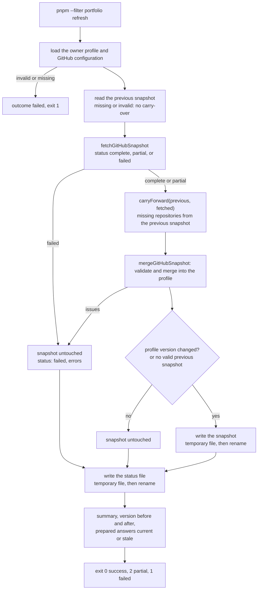
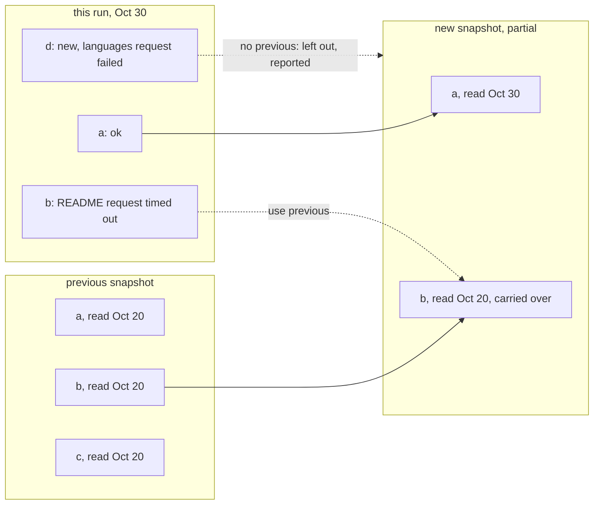
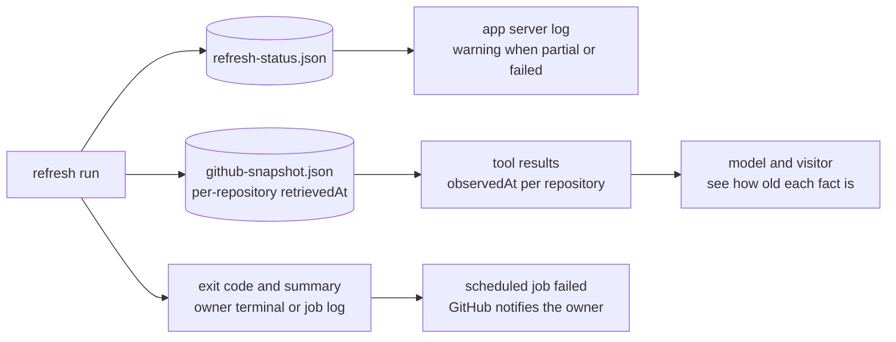
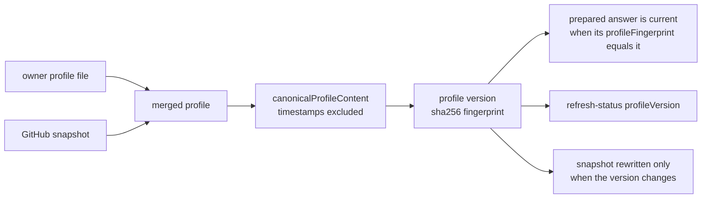
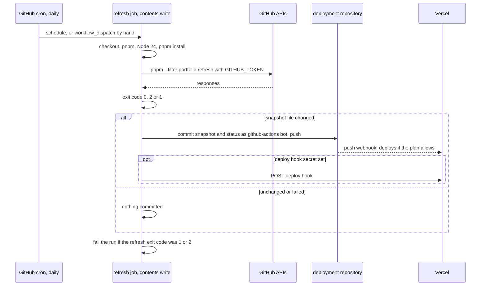

# M9 plan: refresh pipeline and profile versions

- **Status:** Done (2026-10-30). Plan approved with all recommended defaults, and implementation
  approved by the developer on 2026-10-30 (see [Decisions](#decisions) and
  [Review results](#review-results)). Check 18 found an M8 pinned-query bug, fixed with approval
  (Observations). The workflow itself is not run until M12.
- **Date:** 2026-10-30
- **Roadmap:** [M9 — Refresh pipeline and profile versioning](../ROADMAP.md#m9--refresh-pipeline-and-profile-versioning)

This plan is self-contained so it can be discussed outside the coding session. Background:
[architecture overview](../ARCHITECTURE.md), [M7 plan](m7-prepared-starter-answers.md)
(fingerprints, owner-run script), [M8 plan](m8-github-source-adapter.md) (fetch command, "decision
B: schedule in M9", Review results, Observations),
[ADR 0001](../adr/0001-reference-app-framework.md) (serverless: no in-memory state),
[ADR 0006](../adr/0006-profile-data-location.md) (profile files, deployment undecided),
[ADR 0008](../adr/0008-prepared-answers-as-files.md) (prepared answers as reviewed files),
[ADR 0009](../adr/0009-github-source-as-fetched-snapshot.md) (GitHub as a fetched snapshot), and
the learning notes on [source adapters and snapshots](../learning/source-adapters-and-snapshots.md),
[calling external APIs](../learning/calling-external-apis.md), and
[prepared answers and invalidation](../learning/prepared-answers-and-invalidation.md).

## Objective

Turn M8's fetch command into a **refresh**: one unattended command that updates every fetched
source of a profile (today: GitHub), never replaces good data with worse data, records **what
happened** in a status file, and tells whether the profile's **version** changed, so that prepared
answers and a deployment can follow.

Concretely, M9 adds:

1. **Three outcomes instead of two.** Today a refresh either writes everything or nothing. M9
   distinguishes *success*, *partial* (some repositories could not be read: their previous,
   known-good data is kept, with its own older observation date), and *failed* (nothing written).
2. **Observable status.** A small status file next to the snapshot records the last attempt, its
   outcome, what was carried over, and the errors. The command's exit code says the same.
3. **Profile versions without storage.** The version of a profile is its content fingerprint
   (`sha256:…` of `canonicalProfileContent`), already used by prepared answers. No counter, no
   database. The snapshot is rewritten only when that version changes, so "a new file in Git"
   means "a new version".
4. **A schedule, documented and ready.** A GitHub Actions workflow template and a guide, checked
   against GitHub's and Vercel's documentation, for the repository that will deploy a real
   profile. It is not activated in this reference repository (see [decision 6](#open-decisions)).

## Starting point (after M8)

- `pnpm --filter portfolio fetch-github` ([scripts/fetch-github.ts](../../apps/portfolio/scripts/fetch-github.ts))
  loads the owner profile, reads `profile/<profile>.github.json`, calls `fetchGitHubSnapshot`,
  checks the result with `mergeGitHubSnapshot`, and writes `profile/<profile>.github-snapshot.json`
  through a temporary file and a rename. **All or nothing:** any failed request (a missing README
  is not one) means no file is written and exit code 1.
- After writing, it compares `canonicalProfileContent` of the profile before and after and prints
  whether prepared answers are now stale. It **always** rewrites the snapshot on success, so
  `retrievedAt` changes on every run even when nothing else did.
- `fetchGitHubSnapshot` returns `{ ok: true, snapshot, warnings, requests }` or
  `{ ok: false, errors, requests }`. Per-repository errors (`http`, `network`, `timeout`,
  `malformed`) do not stop the remaining requests; `not-found`, `not-a-user`, `unauthorized`,
  `rate-limited`, and `budget` stop at once (`FATAL`).
- The snapshot (`formatVersion: 1`) has one `retrievedAt` for the whole file. Normalization gives
  every repository `observedAt = retrievedAt` through `addObservedRecords` in core.
- Prepared answers carry `profileFingerprint` (SHA-256 of canonical content, timestamps excluded)
  and `instructionsFingerprint`. `profileFingerprint` lives in `@promptfolio/ai` and is not
  exported. Core cannot compute it: its `lib` is `ES2023` only, without Web Crypto types.
- The app reads profile, configuration, snapshot, and answers on every request. An invalid
  snapshot fails the profile load (M8 decision 12).
- This repository has **no Git remote and no `.github/` directory**. The example profile has no
  GitHub source. A real profile lives only in gitignored `*.local.*` files (ADR 0006), and its
  deployment repository is undecided until M12.
- M8 Observations left two small items: homepages without a scheme are dropped, and the model
  called unlicensed repositories "open-source" and wrote "repositories by …".

## Concepts introduced

1. **Last known good.** When a source cannot be read, keep the most recent data that *was* read
   successfully, labelled with *when* it was read, instead of erasing it or pretending it is new.
   M8 did this for the whole snapshot; M9 does it per repository.
2. **Refresh status.** A record of the refresh itself (when it ran, what happened, what was kept
   from before), separate from the data. Data says what the source showed; status says how sure
   we are that it is current. They are written by the same run but answer different questions.
3. **Content-addressed versions.** A version id computed from the content (a hash) instead of a
   counter. Two machines that see the same content agree on the version without coordination or
   storage, which is what a serverless app needs. "Publishing" a version is deploying the files
   that produce it.
4. **Idempotent jobs.** Running the refresh twice with no change on GitHub leaves the files
   byte-for-byte unchanged. That property is what lets a scheduled job decide "commit or not"
   with a plain `git diff`.
5. **Scheduled jobs in CI.** A cron-triggered GitHub Actions workflow as the "server" that a
   serverless app lacks: its token, its permissions, why its pushes do not start other
   workflows, when GitHub disables it, and how a push reaches the host.

## Design

### What a refresh is (decision 1)

A refresh updates the **fetched** sources of one profile. The profile file itself is not
refreshed: the owner edits it, and the app reads it on every request. Today the only fetched
source is GitHub, so a refresh is M8's fetch plus status, carry-over, and the version check.



- **Name:** the command becomes `pnpm --filter portfolio refresh`
  (`apps/portfolio/scripts/refresh.ts`), replacing `fetch-github`. With one fetched source the
  names mean the same; the generic name is the one a schedule and a second source will use.
- **Orchestration in the app, testable.** The command is a thin wrapper around
  `runRefresh(options)` in `apps/portfolio/src/server/refresh.ts`, which takes the directory, an
  injectable `fetch`, a clock, and the token, and returns a typed result. Tests run it against a
  temporary directory with fixtures, as M8's `profile.test.ts` does.
- **Exit codes** follow `prepare-answers`: `0` success, `2` partial (data written, but not
  everything is current), `1` failed (nothing written). A scheduled job can commit on 0 and 2 and
  still report 2 as a failed run.

### Per-repository last known good (decision 2)



Rules (pure function `carryForward` in `@promptfolio/source-github`):

| Situation in this run | Result |
| --------------------- | ------ |
| Repository selected and both its requests succeeded | fresh entry, `retrievedAt` = this run |
| Selected, a per-repository request failed (`http`, `network`, `timeout`, `malformed`), in the previous snapshot | previous entry, with its old `retrievedAt`; listed as carried over |
| Selected, failed, **not** in the previous snapshot | left out (it was never shown, so nothing valid is erased); listed as not added |
| Not selected any more (deleted, renamed, made private, excluded, pushed out of the cap) | gone: that is a real change, not a failure |
| A fatal error: account, repository list, token, rate limit, budget | **failed**: nothing written, as in M8 |
| Previous snapshot missing or invalid | no carry-over: any per-repository failure makes the run failed |

- **Selection comes from this run, entries from one observation.** Which repositories appear,
  and in what order, comes from this run's repository list. A carried repository's entry is the
  **whole previous entry**, metadata included: combining this run's description with the
  previous run's README would put two observation times in one record, and its `observedAt`
  would be wrong for one of them.
- **Per-repository observation time.** The snapshot moves to `formatVersion: 2`: every repository
  gets its own `retrievedAt`; the top-level `retrievedAt` is the time of the run that wrote the
  file. Version 1 files are still read (each repository takes the file's `retrievedAt`), so
  existing snapshots keep working.
- **Honest dates downstream.** `normalizeGitHubSnapshot` passes each repository's `retrievedAt`
  as its `observedAt`, so a carried repository's tool result says it was observed on Oct 20,
  not Oct 30. `addObservedRecords` in core accepts an optional `observedAt` per repository
  (not after the source's `retrievedAt`), defaulting to the source's time as today.
- **The fetcher's result becomes explicit.** `FetchGitHubResult` changes from `ok: true | false`
  to `status: "complete" | "partial" | "failed"`. A `partial` result carries the fresh entries,
  the selected order, and the errors per missing repository. Changing `ok` to mean "maybe
  partial" would silently break M8's all-or-nothing promise for any caller; a new discriminant
  makes the type checker find every caller (there is one: the command).
- **No limit on how long an entry is carried** in M9: its date shows its age. If a repository
  fails every day, the status file and the job's failure say so (see below).

### Refresh status: what is stored and who sees it (decision 3)

A status file next to the snapshot, written atomically at the end of every run, including failed
ones: `profile/<profile>.refresh-status.json`, gitignored as `*.local.refresh-status.json`.

```json
{
  "formatVersion": 1,
  "profileVersion": "sha256:…",
  "sources": {
    "github": {
      "lastAttemptAt": "2026-10-30T04:17:09.000Z",
      "outcome": "partial",
      "lastSuccessAt": "2026-10-29T04:17:12.000Z",
      "snapshotWritten": true,
      "versionChanged": true,
      "carriedOver": [{ "repository": "jordan-example/markdown-linter", "retrievedAt": "2026-10-20T04:16:58.000Z" }],
      "notAdded": ["jordan-example/new-tool"],
      "errors": [{ "kind": "timeout", "target": "repos/jordan-example/markdown-linter/readme", "message": "GitHub did not answer in time" }]
    }
  }
}
```

- **Profile-level file, one entry per source.** The refresh is per profile; a second source
  adds a key. `profileVersion` is the version after the run (unchanged on failure).
- **The three states of spec 3.4** map directly: `outcome` says success, partial, or failed;
  `lastSuccessAt` and each carried entry's `retrievedAt` say which known-good data is in use.
- **Errors are the sanitized M8 messages** (kind, target, message): no token, headers, or bodies.
- **The schema lives in the app** (`src/server/refresh-status.ts`): the app owns the files and
  the orchestration. It moves to a package if M12's second consumer needs it, not before.

Who sees what:



- **Owner:** the command's output and exit code; the job's failed run (GitHub notifies about
  failed workflow runs); the status file; and a server-log warning from the app when the status
  says `partial` or `failed` (for example "2 repositories carried over from 2026-10-20", "last
  refresh failed at …, GitHub data is from …"). Warnings are logged, never shown on the page,
  exactly like today's profile warnings.
- **Visitors and the model:** no failure messages. What protects them from "stale data presented
  as current" is the observation date on every record, which is now correct per repository.
- **The status file never fails the load.** It is informational: missing means "no refresh
  recorded", invalid means one warning. The snapshot keeps M8's rule (invalid fails the load),
  because the refresh never writes an invalid one.
- **Not stored elsewhere.** No database or key-value store: ADR 0001's concern was in-memory
  state between requests, and a file deployed with the data has none. The same reasoning as ADR
  0008.

### Profile versions and prepared answers (decision 4)



- **The version id is the content fingerprint.** It already exists, already ignores observation
  timestamps, and already decides prepared-answer validity. A counter would need somewhere to
  keep the last number (a file every machine must agree on) and adds nothing a hash does not
  give. `@promptfolio/ai` exports `profileFingerprint` so the app can print and record it; it
  stays in `ai` because core has no Web Crypto types (moving it would add `@types/node` or the
  DOM library to core for one function).
- **"Published" means deployed.** The served version is the fingerprint of the files a
  deployment was built from; in Git, the commit that contains them. M9 records no separate
  publish step.
- **The snapshot is rewritten only when the version changes** (or when there is no valid
  previous snapshot). This is the main behavioural change from M8 and makes the refresh
  idempotent: a run that finds nothing new changes only the status file. Consequence: the
  snapshot's dates mean "first observed in this form", which can be older than the last check.
  That understates freshness, never overstates it; the status file's `lastSuccessAt` has the
  last check.
- **Prepared answers.** Their `profileFingerprint` is the version they belong to. After a run the
  command reports "prepared answers: 4 of 5 belong to the current version" or "all stale: run
  `pnpm --filter portfolio prepare-answers`". It does **not** run the generator (decision 5).
  Until someone does, starters are answered live: never stale, only slower and costlier, which
  meets the spec ("invalidate or recompute").

### Regenerating prepared answers after a change (decision 5)

Recommended: **not automatic in M9.** Reasons:

- ADR 0008 makes answers *reviewed* files: "the owner reads it before committing". A job that
  commits model output without review changes that decision.
- It needs a model key as a repository secret and spends 10 to 15 model calls per change; the
  free tiers already rejected bursts (Gemini 15 per minute, OpenRouter's free daily limit stopped
  M8 criterion 31).
- READMEs make content changes frequent, so the job could regenerate often for small changes.

The workflow template shows it as an opt-in step (off by default, a separate
`prepare-answers` step only when the snapshot changed and a model key secret exists), with this
trade-off written next to it. The owner's normal loop is: the job commits new data, starters go
live, the owner runs `prepare-answers` locally, reviews, commits.

### Scheduling (decision 6)

Facts checked in the official documentation on 2026-10-30:

| Fact | Source |
| ---- | ------ |
| Scheduled workflows run on the default branch, at most every 5 minutes, in UTC by default; they can be delayed under load, especially at the start of every hour, and queued jobs may be dropped | GitHub: [events that trigger workflows, `schedule`](https://docs.github.com/en/actions/reference/workflows-and-actions/events-that-trigger-workflows#schedule), [workflow syntax](https://docs.github.com/en/actions/reference/workflows-and-actions/workflow-syntax) |
| "In a public repository, scheduled workflows are automatically disabled when no repository activity has occurred in 60 days." Private repositories are not affected by this rule | same page |
| Events triggered by `GITHUB_TOKEN` do not create new workflow runs, except `workflow_dispatch` and `repository_dispatch` (a push by the job starts no CI or deploy workflow) | GitHub: [`GITHUB_TOKEN`](https://docs.github.com/en/actions/concepts/security/github_token) |
| `GITHUB_TOKEN` rate limit: 1,000 REST requests per hour per repository; unauthenticated: 60 per hour | GitHub: [REST rate limits](https://docs.github.com/en/rest/using-the-rest-api/rate-limits-for-the-rest-api) |
| A `304` from a conditional request does not count against the primary rate limit only when the request is authorized | GitHub: [REST best practices](https://docs.github.com/en/rest/using-the-rest-api/best-practices-for-using-the-rest-api) |
| `permissions:` set explicitly turns every unlisted permission to `none`; `concurrency` allows one running workflow per group | GitHub: [workflow syntax](https://docs.github.com/en/actions/reference/workflows-and-actions/workflow-syntax) |
| Vercel for GitHub deploys every push by default, through its GitHub App webhook (not a GitHub workflow, so the `GITHUB_TOKEN` rule above does not apply to it) | Vercel: [Vercel for GitHub](https://vercel.com/docs/git/vercel-for-github) |
| On a Hobby team with a **private** repository, "only the account owner can trigger deployments"; Vercel's docs do not say how commits by `github-actions[bot]` are treated | Vercel: [why aren't commits triggering deployments](https://vercel.com/kb/guide/why-aren-t-commits-triggering-deployments-on-vercel) |
| Deploy Hooks: a secret URL that starts a deployment of a chosen branch on `GET` or `POST`, no other authentication, 60 triggers per hour per project, 5 hooks per project on Hobby | Vercel: [Deploy Hooks](https://vercel.com/docs/deploy-hooks) |
| Current action majors: `actions/checkout@v7`, `pnpm/action-setup@v6` (reads the pnpm version from `packageManager`, does not install Node), `actions/setup-node@v7` (`cache: pnpm`, `node-version: 24`) | their READMEs on GitHub |

What this means:

- **The M8 recommendation holds** (daily Actions workflow, built-in `GITHUB_TOKEN`, commit the
  snapshot when the version changed), with two caveats the deployment must settle:
  1. **Whether the push redeploys** depends on the host and plan. On Vercel Hobby with a private
     repository, a bot's push may be blocked as "not the owner" (not documented either way); a
     Deploy Hook called by the job after its push avoids the question. The template includes
     that step, enabled only when a `VERCEL_DEPLOY_HOOK_URL` secret exists.
  2. **The 60-day rule** only matters if the deployment repository is public. Whether the job's
     own commits count as "repository activity" is not stated; after 60 quiet days the owner may
     have to re-enable the workflow. A private deployment repository (the likely case: it holds
     a real profile) is not affected.
- **Pushes by the job do not trigger the repository's other workflows** (by design, to prevent
  loops). That is fine for CI; a deployment done by a GitHub workflow instead of Vercel's app
  would have to run in the same job or be dispatched.
- **What M9 builds:** the refresh command and everything it writes (fully tested), plus
  `docs/guides/scheduled-refresh.md` with the workflow file and a setup checklist. The workflow
  is **not** added as `.github/workflows/…` here: this repository has no remote, its example
  profile has no GitHub source (a daily job would fail every day or do nothing), and the
  reference repository must stay profile-independent. It is activated in the deployment
  repository (M12), where its first real run is that milestone's check.

The template's shape:



Key lines of the template (full file in the guide):

```yaml
on:
  schedule:
    - cron: "17 4 * * *" # off the hour: runs at the start of an hour are delayed most
  workflow_dispatch:
permissions:
  contents: write
concurrency:
  group: refresh-profile
```

- The commit step checks `git diff --quiet` on the snapshot only, then adds the snapshot and the
  status file. Because the refresh is idempotent, "snapshot changed" equals "version changed".
- `timeout-minutes: 10`, no retries: the next day is the retry, as in M8.
- The profile file name comes from a repository variable, the token from `secrets.GITHUB_TOKEN`.

### Conditional requests (decision 7)

M8 listed `ETag` requests for M9. Recommended: **not now.** A `304` saves rate limit only when
the request is authorized, and the authorized budgets (1,000 per hour for the job, 5,000 with a
personal token) are 20 to 100 times one run's 43 requests. Without a token, conditional requests
save nothing. It would add stored ETags per URL for no current benefit; revisit if M8.1's search
requests make the budget tight.

### M8 observations (decision 8)

- **Homepage without a scheme** (`shop.amankumar.cc`): out of M9. Adding `https://` guesses the
  scheme, and it is a normalization rule unrelated to refresh. Keep the drop-with-warning; the
  owner can fix the homepage on GitHub, or a one-line rule can be approved separately.
- **"Open-source" and "by" in answers:** out of M9, into M11. It is a system-prompt change (it
  invalidates every prepared answer through the instructions fingerprint) and needs the
  evaluation set M11 builds to show the new wording works. Recorded in the M11 roadmap entry.

## Scope

**In:**

- `@promptfolio/source-github`: `FetchGitHubResult` with `status: complete | partial | failed`;
  snapshot `formatVersion: 2` with per-repository `retrievedAt` (version 1 still read);
  `carryForward(previous, fetched)` (pure); normalization passes per-repository `observedAt`.
- `@promptfolio/core`: optional per-repository `observedAt` in `addObservedRecords`.
- `@promptfolio/ai`: export `profileFingerprint` (no behaviour change).
- App: `src/server/refresh.ts` (`runRefresh`), `src/server/refresh-status.ts` (schema, read,
  write), `scripts/refresh.ts` replacing `scripts/fetch-github.ts`, the `refresh` package script,
  status warnings in the profile load, `.gitignore` line, `.env.example` wording.
- Docs: `docs/guides/scheduled-refresh.md` (workflow template, setup checklist, the facts above),
  ADR 0010, update notes on ADR 0009 and ADR 0001, architecture overview, roadmap (M9 status when
  approved, the M11 note), learning notes.

**Out:**

- An active workflow in this repository; any real run of a scheduled job (M12, in the deployment
  repository).
- Automatic regeneration of prepared answers (template step only, off by default).
- Conditional requests, retries, a maximum carry-over age.
- Showing refresh status or failures to visitors; a status page or endpoint.
- Refreshing the owner profile file; any new source; M8.1 contributions.
- The homepage-scheme rule and the "open-source"/"by" prompt wording.
- Choosing where a real profile is deployed from (ADR 0006, M12).

## Files likely to change

```
packages/source-github/src/fetch.ts, fetch.test.ts                (status complete, partial, failed)
packages/source-github/src/snapshot.ts, snapshot.test.ts          (formatVersion 2, per-repository retrievedAt, v1 read)
packages/source-github/src/carry-forward.ts, carry-forward.test.ts (new: per-repository last known good)
packages/source-github/src/normalize.ts, normalize.test.ts        (observedAt per repository)
packages/source-github/src/index.ts, index.test.ts                (exports)
packages/core/src/profile/observed.ts, observed.test.ts           (optional observedAt per repository)
packages/core/src/profile/types.ts, schema.ts                     (RepositoryInput.observedAt)
packages/ai/src/index.ts, index test if present                   (export profileFingerprint)
apps/portfolio/src/server/refresh.ts, refresh.test.ts             (new: runRefresh)
apps/portfolio/src/server/refresh-status.ts, refresh-status.test.ts (new: status file)
apps/portfolio/src/server/github-source.ts, profile.test.ts       (status warnings, file name)
apps/portfolio/scripts/refresh.ts                                 (new, replaces fetch-github.ts)
apps/portfolio/scripts/fetch-github.ts                            (removed)
apps/portfolio/package.json                                       (refresh script replaces fetch-github)
apps/portfolio/.env.example                                       (command name)
.gitignore                                                        (*.local.refresh-status.json)
docs/guides/scheduled-refresh.md                                  (new)
docs/adr/0010-refresh-status-and-content-versions.md              (new)
docs/adr/0009-…, docs/adr/0001-…                                  (update notes)
docs/ARCHITECTURE.md, docs/ROADMAP.md
docs/learning/… (see Learning notes)
```

## Dependencies

**No new dependency.** File writes use `node:fs/promises` (`writeFile`, `rename`) as M8 does;
hashing reuses `profileFingerprint` (Web Crypto `crypto.subtle.digest`, already used in `ai`);
validation uses `zod` from the catalog. The workflow template uses `actions/checkout@v7`,
`pnpm/action-setup@v6`, and `actions/setup-node@v7`, checked in their READMEs on 2026-10-30
(versions are rechecked when the template is activated in M12). Platform facts are in the table
under [Scheduling](#scheduling-decision-6).

Alternatives considered:

- **Key-value store for status and versions** (for example a hosted Redis or Vercel's storage
  products): live status without a commit, but a new service, secret, and failure mode, for data
  that only the owner reads.
- **Vercel Cron calling a route that refreshes:** the route would need the token at run time, the
  serverless filesystem is read-only, so the result would have to go to a store anyway.
- **Committing the status on every run:** a deployed status that is always current, at the cost
  of a commit and a redeploy every day without any data change.

## Acceptance criteria and tests

Deterministic, no network: fake `fetch` returning fixture `Response`s, a fixed clock, temporary
directories.

**Adapter** (`fetch.test.ts`, `snapshot.test.ts`, `carry-forward.test.ts`, `normalize.test.ts`):

1. A run where every request succeeds gives `status: "complete"`, every repository with
   `retrievedAt` from the clock.
2. A README timeout, a 500 on languages, and a malformed languages body each give `status:
   "partial"` with the fresh entries, the selection order, and the error for that repository;
   the remaining repositories are still requested.
3. Fatal errors (user 404, organization, 401, rate limit, budget) still give `status: "failed"`
   and stop, as in M8 (existing tests keep passing, adapted to the new discriminant).
4. `carryForward`: a failed repository present in the previous snapshot is carried whole with its
   old `retrievedAt`, in this run's selection order; one absent from it is left out and reported;
   a repository no longer selected disappears; no previous snapshot turns any per-repository
   failure into `failed`; a complete run is returned unchanged.
5. Snapshot version 2 parses; version 1 parses and gives each repository the file's
   `retrievedAt`; a repository `retrievedAt` after the file's is rejected.
6. Normalization gives each repository its own `observedAt`.

**Core** (`observed.test.ts`):

7. `addObservedRecords` uses a repository's `observedAt` when given, the source's otherwise; an
   invalid date or one after `retrievedAt` is an issue.
8. Canonical content is the same whether a repository was carried or fresh with equal data (the
   version ignores observation times).

**App** (`refresh.test.ts`, `refresh-status.test.ts`, `profile.test.ts`, temporary `profile/`):

9. First complete run: snapshot and status written, exit code 0, `versionChanged: true`.
10. Second run with identical fixtures: the snapshot file is **byte-identical** (idempotency), the
    status shows `success` and `versionChanged: false`, exit code 0.
11. Partial run: snapshot written with a carried repository, status `partial` with `carriedOver`
    and errors, exit code 2; the merged profile's repository has the old `observedAt`.
12. Failed run: snapshot byte-identical to before, status `failed` with errors and the previous
    `lastSuccessAt`, exit code 1.
13. Data that fails `mergeGitHubSnapshot` (for example a role id equal to a repository id) is
    `failed`, nothing written.
14. A changed fixture changes `profileVersion`; the report counts prepared answers of the current
    version (fixture answers file with one matching and one stale fingerprint).
15. Status file: missing gives no warning; `partial` and `failed` give one server-log warning
    each; an invalid status file gives one warning and the profile still loads.
16. No status or log text contains the token or a response body.
17. `git check-ignore` confirms `profile.local.refresh-status.json` is ignored.

**Manual checks** (network and the developer's account; run only with approval):

18. With the `check.local` test profile (`amanx5`), `pnpm --filter portfolio refresh`: success,
    status file written, version printed; the existing version 1 snapshot is replaced only if
    the content changed.
19. Run it again at once: `git diff --no-index` against a copy shows the snapshot unchanged.
20. Point the configuration at a non-existent user: exit code 1, snapshot unchanged, status
    `failed`; then the app logs the warning on page load.
21. `pnpm verify` passes.

Not checked in M9, stated in the review: the workflow itself, the Vercel redeploy behaviour, and
the 60-day rule (all in the deployment repository, M12).

## Open decisions

Each has a recommended default; the developer decides.

| # | Question | Recommended default | Alternatives |
| - | -------- | ------------------- | ------------ |
| 1 | What a refresh is, and the command name | Update fetched sources (GitHub) with status and version check; `refresh` replaces `fetch-github` | Keep `fetch-github` and add the features to it; keep both names as aliases |
| 2 | Partial failure | Per-repository last known good: carry the whole previous entry with its own `retrievedAt`; new repositories that fail are left out; fatal errors still fail the run | Keep all or nothing (simpler, but one flaky README blocks every update) |
| 3 | Where status is stored and who sees it | `profile/<profile>.refresh-status.json` written on every run; owner sees exit code, job failure, file, server-log warning; visitors see only correct per-record dates; committed by the job only together with a snapshot change | Status inside the snapshot (a failed run would have to rewrite the data file); a key-value store; committing status daily |
| 4 | Profile version | The content fingerprint is the version; "published" means deployed; snapshot rewritten only when the version changes | A counter in a file; always rewrite the snapshot (M8 behaviour, daily commits) |
| 5 | Regenerate prepared answers after a change | Not automatic: report stale answers, owner runs `prepare-answers` and reviews; opt-in step in the template | Run the generator in the job with a model key secret and commit unreviewed answers |
| 6 | Scheduling | Document and template a daily GitHub Actions workflow (built-in token, commit on change, optional deploy hook) in `docs/guides/`; activate it in the deployment repository in M12 | Add `.github/workflows/` here now (fails or idles daily on the example profile); Vercel Cron (needs a store) |
| 7 | Conditional requests (`ETag`) | Deferred: no budget pressure, and no saving without a token | Implement now |
| 8 | M8 observations | Homepage without scheme: keep dropping, not in M9. "Open-source"/"by" wording: M11 with the evaluation set | Fix either in M9 |
| 9 | ADR | ADR 0010 for status, per-repository last known good, and content versions; update notes on 0009 (all or nothing) and 0001 (versions needed no storage) | Update notes only |

Small defaults changeable in review without changing the design: exit code 2 for partial, the
status file name, 04:17 UTC, a 10-minute job timeout.

## Learning notes

- **New:** `docs/learning/refresh-status-and-last-known-good.md`: data versus status, the three
  outcomes, per-record observation times, why understating freshness is safe and overstating it
  is not, idempotent jobs. Written as "planned" if approved, "in use" when M9 lands.
- **New:** `docs/learning/scheduled-jobs.md`: cron in GitHub Actions (UTC, delays, default
  branch, the 60-day rule), `GITHUB_TOKEN` and its permissions, why its pushes start no
  workflows, how a push reaches the host (webhook versus deploy hook), and why this repository
  only documents the job. Marked "planned" for the parts that run only in M12.
- **Updated:**
  - prepared answers and invalidation (the fingerprint is the profile version; refresh reports
    stale answers; why regeneration is not automatic);
  - source adapters and snapshots (per-repository last known good replaces all or nothing,
    snapshot version 2, write only on change, the `refresh` command);
  - calling external APIs (partial failure as a result type; conditional requests and why they
    are deferred);
  - server-side secrets (`GITHUB_TOKEN` inside Actions, the deploy hook URL as a secret, a model
    key secret only if regeneration is turned on);
  - provenance and basis (`observedAt` per repository, carried records);
  - the README index.

## Decisions

Approved by the developer on 2026-10-30 ("pls proceed", relayed from the M8 session) with every
recommended default in [Open decisions](#open-decisions): `refresh` replaces `fetch-github`;
per-repository last known good; a status file next to the snapshot; the content fingerprint as
the profile version, snapshot written only on a new version; no automatic answer regeneration;
the schedule as a documented template, not active here; conditional requests deferred; the M8
observations left out of M9 (the wording one recorded under M11); ADR 0010.

## Review results

Recorded 2026-10-30.

**Deviations from the plan (small, explained here):**

- **Setup errors write no status.** A missing or invalid profile or GitHub configuration stops the
  command with exit code 1 before anything is fetched, and no status file is written: there was no
  refresh attempt to describe. Every run that reaches the fetch writes one.
- **The fetcher stops before the per-repository requests** if anything before them failed (the
  repository list, a pinned repository outside the first 100). In M8 it went on and failed at the
  end; now no requests are spent on a run that cannot succeed.
- **Exports:** `@promptfolio/source-github` also exports the types `MissingRepository` and
  `SnapshotRepository`; `@promptfolio/ai` exports `profileFingerprint` unchanged.
- **The status is validated before it is written** (`parseRefreshStatus`), so the command never
  writes a file the app would reject. Text fields are capped at 500 characters and lists at 100.
- **The version before a run** comes from `loadAppProfile` with the current snapshot; if that load
  fails (for example an invalid snapshot), it is `null`, so the run counts as a version change and
  writes a valid snapshot.
- **Tests for the status file live in `refresh.test.ts`**; no separate `refresh-status.test.ts`.
  `@promptfolio/ai` has no index test to update.
- `normalizeGitHubSnapshot` sets `observedAt` only for a repository whose `retrievedAt` differs from
  the snapshot's, so ordinary records are unchanged.

**Automated:** `pnpm verify` passes: lint, typecheck in all four packages, 351 tests (`core` 68,
`source-github` 77, `ai` 108, app 98; 310 before M9; 2 of them for the pinned-query fix below),
and the build. The build shows the same two
"dynamic filesystem access" warnings for `src/server/prepared-answers.ts` as before M9, no new
ones. No test uses the network or a model.

Acceptance criteria 1 to 17 are covered by tests:

| # | Where |
| - | ----- |
| 1-3 | `fetch.test.ts`: complete run with `formatVersion: 2` and per-repository time; partial after a 500, a malformed body, or a README timeout, with the other repositories still read; fatal errors still `failed` |
| 4 | `carry-forward.test.ts`: whole previous entry in selection order, not-added, dropped when unselected, case-insensitive names, no previous snapshot or another account fails |
| 5 | `snapshot.test.ts`: version 2 parses, version 1 is upgraded, a repository time after the file's is rejected, version 2 without per-repository times is rejected |
| 6 | `normalize.test.ts`: own `observedAt` for an earlier repository |
| 7-8 | `observed.test.ts`: per-repository `observedAt`, late or invalid times rejected, canonical content unchanged for carried data |
| 9-14, 16 | `refresh.test.ts`: first run, byte-identical rerun and no temporary files, partial with exit 2 and the old `observedAt` in the loaded profile, failed with exit 1 and the snapshot untouched, partial first run fails, data that does not fit the profile, prepared-answer counts before and after a version change, no token or response body in output, snapshot, or status |
| 15, 17 | `refresh.test.ts`: status warnings (none, invalid, partial, failed), an invalid status does not stop the load, `git check-ignore` for the status file |

**Manual checks** (2026-10-30, approved by the developer; the `check.local` test profile with the
GitHub account `amanx5`; no model calls; the four `check.local` files were backed up first and
are byte-identical to the backup afterwards, and the status file the checks created was removed):

| # | Check | Result |
| - | ----- | ------ |
| 18 | `pnpm --filter portfolio refresh` | **With the token from `.env.local`: failed safely**, exit 1 after 3 requests, snapshot untouched, status `failed` with `malformed graphql: Unexpected response shape at data.user.pinnedItems.nodes.0`. Cause in Observations (an M8 bug in the pinned query, first reached now). **Without the token** (`GITHUB_TOKEN=` for the command): pass, success after 22 requests, 10 repositories, "Profile version unchanged", "Prepared answers: all 3 belong to this version", status `success`. The version 1 snapshot was not rewritten, because the content had not changed since M8 |
| 19 | Rerun at once | Pass: snapshot byte-identical before and after (and identical to the pre-check backup), status `success` with `snapshotWritten: false`, no temporary files left |
| 20 | Non-existent user | Pass: `not-found users/promptfolio-no-such-user-9x7q`, exit 1 after 1 request, snapshot unchanged, status `failed` with `lastSuccessAt` from check 19. `profileVersion` is `null` in that status, because the profile with a snapshot of another user does not load (expected). With the configuration restored, `loadAppProfile` (what the page calls) loads 10 repositories and returns the warning "Last GitHub refresh failed at …; last success at …; the previous data is still in use", logged in the page's `[profile]` format. Checked with a script, not in the browser |

Criterion 21 is the `pnpm verify` above. The workflow, the host's redeploy behaviour, and the
60-day rule are left for the deployment repository (M12), as planned.

**Observations:**

- **Pinned repositories fail with this token (M8 bug, found by check 18).** The developer's token
  now in `.env.local` was used for the first time (M8 check 26 was never run). One of the 6 pinned
  items is a repository of the `jsoc-dev` organization, which forbids fine-grained tokens with a
  long lifetime. GitHub's GraphQL API then answers 200 with partial data: that node is `null`, and
  `errors` has one `FORBIDDEN` entry whose `path` is `user.pinnedItems.nodes.0`. The other five
  nodes are fine (two own repositories, one fork, two of other owners). The M8 schema rejects the
  `null` node as malformed, and the code treats any GraphQL error as fatal (`unauthorized`). Since
  pinned repositories of other owners are skipped anyway, a fix would accept `null` nodes and treat
  errors whose path points into `pinnedItems.nodes` as "skip this item, with a warning", failing
  only on other errors.

  **Fixed with the developer's approval** ("Fix it here", 2026-10-30), a change to M8 code made
  during M9: `pinnedResponseSchema` accepts `null` nodes and reads only `path` and `type` of
  GraphQL errors (never `message`); `fetchPinned` skips an item whose error path is
  `user.pinnedItems.nodes.<index>`, with the warning "Skipped pinned item N: GitHub did not return
  it (FORBIDDEN)", and still fails as `unauthorized` on any other error or without the user. Tests
  in `fetch.test.ts`: a forbidden middle item is skipped while the other pinned repositories stay
  first, the error message never reaches a warning, and an error that is not about one item still
  stops the run. **Rerun of check 18 with the token:** pass, success after 23 requests; pinned item
  1 skipped (FORBIDDEN), `microsoft/vscode` and `golang/go` skipped as other owners' repositories,
  the fork `amanx5/TypeScript` skipped; `amanx5/go-learn` and `amanx5/ecommerce` listed as pinned
  and first. This also covers M8's criterion 26 (pinned first with a token), never run in M8.
  Profile version unchanged, so the snapshot was not rewritten.
- **Snapshot metadata can lag behind.** Because the snapshot is rewritten only for a new profile
  version, fields that are not profile content (`authenticated`, `pinned`) keep the values of the
  run that last changed the content: after the token run the file still says
  `authenticated: false` and `pinned: false`. Selection order, which is content, is current. A
  later content change rewrites them; nothing reads them for answers.

**Not changed:** the example profile and its prepared answers (the example has no GitHub source,
and no instruction or content change touches its fingerprints).
